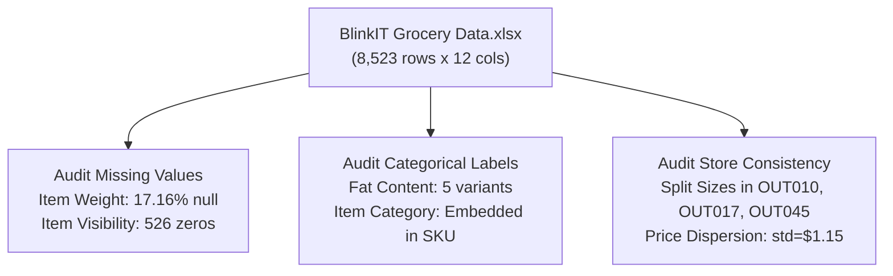
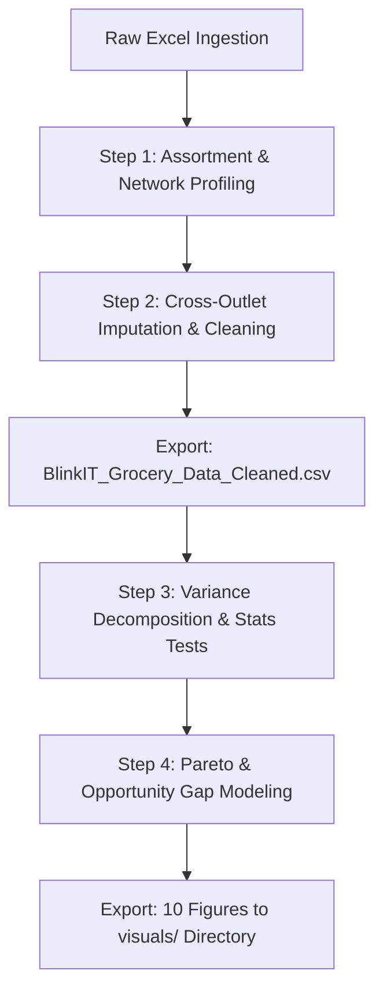
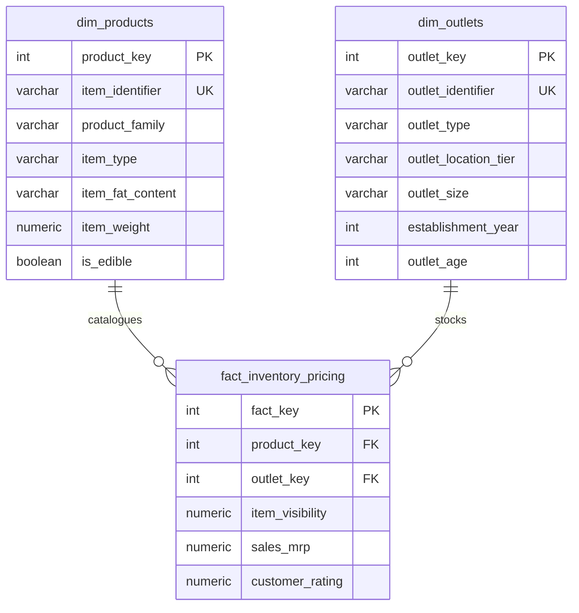
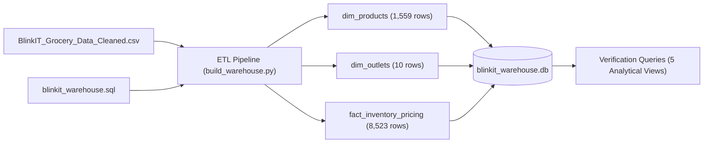
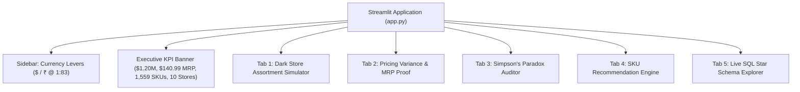
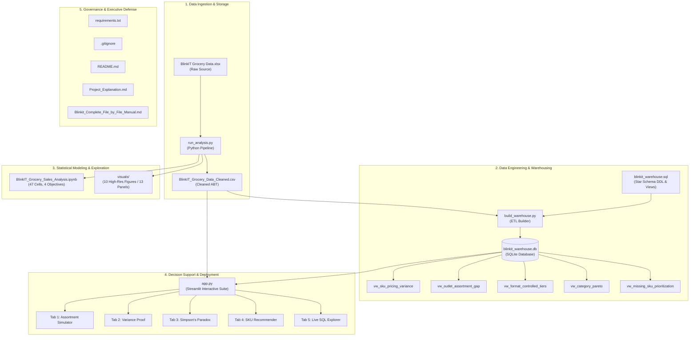

# Blinkit Quick-Commerce Flagship: Minute File-by-File Technical Manual & Execution Guide

---

## 📌 Document Overview

This document provides a granular, file-by-file technical breakdown of every asset in the **Blinkit Flagship Package**. It documents the exact execution steps, mathematical logic, business rationale, data transformations, and architectural flowcharts for each file, demonstrating the standard expected of a **Senior Data Analyst** and **Junior Data Scientist**.

---

## 🗂️ Master Repository Manifest

```text
Blinkit_Flagship_Package/
├── 1. BlinkIT Grocery Data.xlsx            # Raw Data Source
├── 2. run_analysis.py                     # Automated Analysis Pipeline
├── 3. BlinkIT_Grocery_Data_Cleaned.csv    # Cleaned & Engineered Data
├── 4. blinkit_warehouse.sql               # Star Schema DDL & Analytical Views
├── 5. build_warehouse.py                  # Automated SQLite ETL & Verification
├── 6. blinkit_warehouse.db                # Relational SQLite Database
├── 7. app.py                              # Interactive Streamlit Decision Suite
├── 8. BlinkIT_Grocery_Sales_Analysis.ipynb# Main Jupyter Analysis Notebook
├── 9. visuals/                            # 10 Exported High-Resolution Figures
├── 10. requirements.txt                    # Environment Dependencies
├── 11. .gitignore                          # Repository Hygiene Rules
├── 12. README.md                           # Executive Summary & Quickstart
└── 13. Project_Explanation.md             # Defense Manual & Interview Q&A
```

---

# Detailed File-by-File Analysis

---

## File 1: `BlinkIT Grocery Data.xlsx` (Raw Data Source)

### 1.1 Purpose & Role
The raw enterprise snapshot of Blinkit's quick-commerce operations across 10 fulfillment dark stores in Indian metropolitan markets.

### 1.2 Data Characteristics & Audit
- **Dimensions:** 8,523 rows $\times$ 12 columns.
- **Granularity:** One row per product-outlet stocked combination (SKU listed at a specific dark store).
- **Core Anomalies Identified:**
  - `Item Weight`: Missing in **1,463 rows (17.16%)**; completely unrecorded in outlets `OUT019` and `OUT027`.
  - `Item Visibility`: Contains **526 records with a value of 0.00**, which is physically impossible for an active product listed on a digital mobile application.
  - `Item Fat Content`: Inconsistent categorization across 5 raw string formats (`low fat`, `LF`, `Low Fat`, `reg`, `Regular`).
  - `Outlet Size`: Conflicting entries for `OUT010`, `OUT017`, and `OUT045` across different rows.
  - `Sales`: Does not represent volume/register receipts; empirical variance indicates it represents item retail price (MRP).



---

## File 2: `run_analysis.py` (Automated Analysis Pipeline)

### 2.1 Purpose & Role
A standalone Python execution script that programmatically ingests raw data, cleans it, calculates dynamic statistical metrics, runs hypothesis tests, and exports all 10 figures into `visuals/`.

### 2.2 Minute Step-by-Step Breakdown

#### Step 0: Ingestion with Dual-Filename Fallback
- Dynamically locates `BlinkIT_Grocery_Data.xlsx` or `BlinkIT Grocery Data.xlsx`.
- Loads the raw data using `pandas.read_excel()` and verifies row/column shapes.

#### Step 1: Catalogue & Network Profiling (Objective 1)
- **Product Family Derivation:** Maps the first 2 characters of `Item Identifier`:
  - `FD` $\rightarrow$ **Food** (6,125 rows, 71.87%)
  - `NC` $\rightarrow$ **Non-Consumable** (1,599 rows, 18.76%)
  - `DR` $\rightarrow$ **Drinks** (799 rows, 9.37%)
- **Distribution Analysis:** Calculates mean (\$140.99), median (\$143.01), standard deviation (\$62.28), and skewness ($\approx 0.13$, establishing a symmetric, non-skewed price distribution).
- **Rating Cluster Detection:** Identifies that 39.18% of all ratings sit at exactly 4.00, demonstrating lack of consumer score dispersion.

#### Step 2: Data Cleaning & Feature Engineering (Objective 2)
1. **Item Weight Imputation:** Calculates mean weight per SKU across other outlets:
   $$\text{Weight}_{\text{imputed}}(i) = \frac{1}{|O_i|} \sum_{o \in O_i} \text{Weight}(i, o)$$
   If an SKU is completely unweighted network-wide, it falls back to the median weight of its category (`Item Type`).
2. **Zero-Visibility Repair:** Replaces `0.00` visibility with `NaN`, then imputes using cross-outlet mean visibility per SKU, followed by category median fallback.
3. **Fat Content Normalization & Non-Edible Assignment:**
   - Standardizes strings: `low fat` / `LF` $\rightarrow$ `Low Fat`; `reg` $\rightarrow$ `Regular`.
   - If `Item Category == 'Non-Consumable'`, reassigns fat content to `Non-Edible` (eliminating nonsense classifications like "Low Fat Toilet Cleaner").
4. **Outlet Size Conflict Resolution:** Assigns `Unknown` to split stores (`OUT010`, `OUT017`, `OUT045`) rather than applying an arbitrary mode.
5. **Operating Age Calculation:** $\text{Outlet Age} = 2026 - \text{Outlet Establishment Year}$.

#### Step 3: Statistical Testing & Drivers of Sales (Objective 3)
1. **Empirical Variance Decomposition:**
   $$\text{SS}_{\text{total}} = \sum (y_i - \bar{y})^2, \quad \text{SS}_{\text{SKU}} = \sum (\bar{y}_{\text{SKU}} - \bar{y})^2, \quad R^2 = \frac{\text{SS}_{\text{SKU}}}{\text{SS}_{\text{total}}} = 0.9997$$
   - Confirms SKU explains **99.97% of sales variance**, proving row-level `Sales` is unit price / MRP.
2. **Correlation Testing (Pearson):**
   - Visibility vs Price: $r = -0.0060, p = 0.58$ (No correlation)
   - Rating vs Price: $r = 0.0113, p = 0.30$ (No correlation)
   - Store Age vs Price: $r = 0.0007, p = 0.95$ (No correlation)
3. **Non-Parametric ANOVA (Kruskal-Wallis):**
   - Across Categories: $H = 107.30, p = 5.31 \times 10^{-16}$ (Statistically significant category MRP dispersion: Household has higher unit price than Soft Drinks).
   - Across Outlet Types: $H = 0.65, p = 0.88$ (Proves absolute price parity across formats).

#### Step 4: Business Optimization & Opportunity Modeling (Objective 4)
1. **Pareto Assortment Analysis:** Verifies that category share of listings correlates **0.997** with category share of revenue. Top 5 categories generate 59.03% of revenue (\$709,370).
2. **Simpson's Paradox Debunking:** Controls for store format and proves supermarket sales per store are identical across all urban tiers (Tier 1: \$131,295, Tier 2: \$131,050, Tier 3: \$131,334).
3. **Assortment Gap Uplift Model:**
   $$\text{Gap} = (930.0 - 541.5) \times 2 \times \$140.2947 = \mathbf{+\$109,008.97 \quad (+9.07\%)}$$



---

## File 3: `BlinkIT_Grocery_Data_Cleaned.csv` (Curated Dataset)

### 3.1 Purpose & Role
The clean, 100% complete analytical base table (ABT) feeding the database, Streamlit application, and Jupyter notebook.

### 3.2 Feature Dictionary
| Column Name | Type | Processing Applied | Analytical Use |
|---|---|---|---|
| `Item Fat Content` | Categorical | Normalized to `Low Fat`, `Regular`, `Non-Edible` | Segmenting edible products |
| `Item Identifier` | Categorical | Validated format (`FD*`, `DR*`, `NC*`) | Unique SKU identifier ($R^2 = 99.97\%$) |
| `Item Type` | Categorical | 16 discrete product categories | Category pricing tier analysis |
| `Outlet Establishment Year` | Integer | Historical year (2011–2022) | Longevity tracking |
| `Outlet Identifier` | Categorical | 10 stores (`OUT010` to `OUT049`) | Outlet assortment comparisons |
| `Outlet Location Type` | Categorical | `Tier 1`, `Tier 2`, `Tier 3` | Confounder & demographic analysis |
| `Outlet Size` | Categorical | `Small`, `Medium`, `High`, `Unknown` | Physical footprint segmentation |
| `Outlet Type` | Categorical | `Grocery Store`, `Supermarket Type1/2/3` | Primary structural driver of assortment |
| `Item Visibility` | Numerical | Imputed from cross-store SKU mean | Display shelf ratio evaluation |
| `Item Weight` | Numerical | Cross-outlet mean SKU imputed | Physical logistics & handling |
| `Sales` | Numerical | Unit price / MRP ($31.29 to $266.89) | Value modeling & inventory potential |
| `Rating` | Numerical | Verified numerical scale (1.0 to 5.0) | Customer satisfaction assessment |
| `Item Category` | Categorical | Extracted from prefix (`Food`, `Drinks`, `Non-Consumable`) | Macro portfolio breakdown |
| `Outlet Size (Original)`| Categorical | Preserves raw entries prior to `Unknown` recode | Audit trail preservation |
| `Outlet Age` | Integer | $2026 - \text{Establishment Year}$ | Depreciation & maturity driver |

---

## File 4: `blinkit_warehouse.sql` (Dimensional Star Schema)

### 4.1 Purpose & Role
Production ANSI SQL script defining the relational Star Schema DDL, indexing strategy, and 5 advanced analytical SQL views.

### 4.2 Schema Design & Minute DDL Structure



### 4.3 The 5 Analytical SQL Views Explained

#### View 1: `vw_sku_pricing_variance`
- **Logic:** Joins `fact_inventory_pricing` with `dim_products`, grouping by SKU to calculate mean, min, max, and price spread.
- **SQL Technique:** `COUNT()`, `ROUND(AVG(), 2)`, `MAX() - MIN()`.
- **Insight:** Proves price spread across outlets is negligible (mean spread $\approx \$1.15$).

#### View 2: `vw_outlet_assortment_gap`
- **Logic:** Uses CTEs to aggregate total catalogue inventory value per outlet and cross-joins with supermarket benchmark averages.
- **SQL Technique:** Common Table Expressions (`WITH`), conditional aggregation (`CASE WHEN outlet_type != 'Grocery Store'`).
- **Insight:** Isolates the 388.5 SKU gap and \$53k–\$57k catalogue value shortfall in grocery stores.

#### View 3: `vw_format_controlled_tiers`
- **Logic:** Groups by both `outlet_location_tier` and `outlet_type` to calculate `revenue_per_store`.
- **SQL Technique:** Multi-level dimensional aggregation:
  $$\text{Revenue Per Store} = \frac{\sum \text{sales\_mrp}}{\text{COUNT}(\text{DISTINCT outlet\_identifier})}$$
- **Insight:** Debunks Simpson's Paradox by proving that revenue per supermarket is constant at ~\$131k across all tiers.

#### View 4: `vw_category_pareto`
- **Logic:** Calculates category revenue, share of network total, and cumulative running totals using analytical window functions.
- **SQL Technique:** `SUM(revenue) OVER (ORDER BY revenue DESC)` and `ROW_NUMBER() OVER ()`.
- **Insight:** Demonstrates that the top 5 categories account for 59.03% of revenue.

#### View 5: `vw_missing_sku_prioritization`
- **Logic:** Identifies all SKUs stocked in supermarkets but completely missing in grocery dark stores, ranking them by expansion score (`supermarket_presence * mean_mrp`).
- **SQL Technique:** Subquery anti-join (`NOT IN (SELECT item_identifier FROM grocery_skus)`).
- **Insight:** Gives commercial procurement teams an actionable onboarding priority list.

---

## File 5: `build_warehouse.py` (Automated ETL & Verification Engine)

### 5.1 Purpose & Role
Automated Python ETL pipeline that compiles `blinkit_warehouse.sql`, loads `BlinkIT_Grocery_Data_Cleaned.csv` into a relational SQLite database (`blinkit_warehouse.db`), and executes all views to verify integrity.

### 5.2 Minute Step-by-Step Breakdown
1. **Schema Initialization:** Reads `blinkit_warehouse.sql` and executes DDL via `cursor.executescript()`.
2. **Dimension Extraction (Products):**
   - Deduplicates 1,559 SKUs from the cleaned CSV.
   - Derives `is_edible` boolean flag.
   - Assigns 1-indexed surrogate key `product_key`.
   - Inserts records into `dim_products`.
3. **Dimension Extraction (Outlets):**
   - Deduplicates 10 stores.
   - Assigns 1-indexed surrogate key `outlet_key`.
   - Inserts records into `dim_outlets`.
4. **Fact Table Generation:**
   - Performs relational joins between clean data, `dim_products` on `Item Identifier`, and `dim_outlets` on `Outlet Identifier` to map surrogate foreign keys.
   - Assigns `fact_key` (1 to 8,523).
   - Inserts 8,523 rows into `fact_inventory_pricing`.
5. **Analytical View Query Execution:**
   - Runs `SELECT *` across all 5 views and prints formatted output tables to standard console for immediate verification.



---

## File 6: `blinkit_warehouse.db` (Compiled Database)

### 6.1 Purpose & Role
The compiled, indexed SQLite database file. It serves as the live backend powering Tab 4 (SKU Recommender) and Tab 5 (Live SQL Explorer) in the Streamlit application.

### 6.2 Table Statistics
- `dim_products`: 1,559 rows
- `dim_outlets`: 10 rows
- `fact_inventory_pricing`: 8,523 rows
- Views: 5 active analytical views
- Indexes: 8 B-tree performance indexes

---

## File 7: `app.py` (Interactive Streamlit Decision Suite)

### 7.1 Purpose & Role
Production web application designed for executive stakeholders, category managers, and dark store operators.

### 7.2 Architecture & Minute Tab Functions



#### Minute Tab Implementations:
1. **Sidebar:** Real-time currency toggle scaling all metrics dynamically between \$ (USD normalized) and ₹ (INR @ 1:83).
2. **Tab 1 (Assortment Simulator):**
   - User selects store (`OUT010` or `OUT019`).
   - Sliders adjust: Onboarded SKUs (0–388), Target Gross Margin % (10–35%), Inventory Turns (4–24x/yr), Holding Cost % (5–25%).
   - Calculates incremental catalogue value, merchandise velocity, and net annual operating profit.
   - Bar chart updates dynamically with Plotly.
3. **Tab 2 (Pricing Variance):**
   - Plots the $R^2$ variance decomposition bar chart.
   - Interactive dropdown lets users select any SKU and observe its cross-store price stability.
4. **Tab 3 (Simpson's Paradox):**
   - Toggle button switches between the **Naive Aggregated View** (showing misleading Tier 2 outperformance) and the **Format-Controlled View** (demonstrating exact parity across supermarkets).
5. **Tab 4 (SKU Recommender):**
   - Interactive scatter plot of Priority Score vs Unit Price.
   - Live query from `vw_missing_sku_prioritization` with category and presence filters.
   - **One-click CSV download** (`blinkit_recommended_expansion_skus.csv`).
6. **Tab 5 (SQL Warehouse Explorer):**
   - Dropdown to inspect all 5 SQL warehouse views.
   - Interactive SQL text console allowing custom `SELECT` queries against `fact_inventory_pricing`, `dim_products`, and `dim_outlets`.

---

## File 8: `BlinkIT_Grocery_Sales_Analysis.ipynb` (Jupyter Notebook)

### 8.1 Purpose & Role
The interactive computational notebook containing all 47 cells (28 code cells and 19 formatted markdown cells) implementing the 4-phase, 16-task analytical framework.

### 8.2 Cell Workflow
- **Cells 1–7:** Environment initialization, dual-filename loading, structural audit.
- **Cells 8–18:** Objective 1 catalogue profiling, family splits, and distribution diagnostics.
- **Cells 19–27:** Objective 2 data engineering, cross-store imputation, fat standardization, and outlier evaluations.
- **Cells 28–36:** Objective 3 variance decomposition ($R^2 = 0.9997$), statistical tests (Pearson, Kruskal-Wallis), and cohort analysis.
- **Cells 37–47:** Objective 4 Pareto analysis, Simpson's paradox proof, assortment gap model (+\$109k), and strategic recommendations.

---

## File 9: `visuals/` (10 Figures / 13 Panels Visual Suite)

### 9.1 Overview & Figure Manifest
Exported at 150 DPI with zero Seaborn deprecation warnings:

| File Name | Panels | Chart Types | Business Question Answered |
|---|---|---|---|
| `01_product_assortment_family.png` | 2 | Horizontal Bar + Donut Chart | What is the product catalogue composition across categories and families? |
| `02_outlet_network_distribution.png` | 2 | Categorical Bar Charts | How are store formats distributed across urban location tiers? |
| `03_sales_distribution_kde.png` | 1 | Histogram + KDE Density + Mean/Median | What is the distribution shape of product unit prices? |
| `04_customer_rating_analysis.png` | 2 | Histogram + Horizontal Bar Chart | Do customer review scores provide meaningful product differentiation? |
| `05_outlier_boxplots.png` | 4 | Boxplot Quad-Grid | Are extreme values statistical errors or valid commercial items? |
| `06_category_revenue_drivers.png` | 2 | Dual Ranked Bar Charts | Which categories drive total sales vs average unit price? |
| `07_outlet_matrix_parity_proof.png` | 8 | 2x4 Multi-Metric Facet Grid | Do store formats differ in average price or assortment volume? |
| `08_statistical_correlations.png` | 3 | Heatmap + 2 Linear Regression Plots | Does visibility or customer rating correlate with product price? |
| `09_top_bottom_cohort_comparison.png`| 2 | Stacked & Grouped Bar Charts | How do top 25% and bottom 25% price cohorts differ by category? |
| `10_pareto_analysis.png` | 1 | Dual-Axis Pareto Curve (Bar + Line) | Does catalogue concentration follow the 80/20 rule? |

---

## File 10: `requirements.txt` & `.gitignore` (Infrastructure)

### 10.1 `requirements.txt`
Specifies clean minimum version boundaries ensuring complete reproducibility across any Python 3.10+ installation:
- `pandas>=2.0.0`, `numpy>=1.24.0`
- `matplotlib>=3.7.0`, `seaborn>=0.12.0`
- `scipy>=1.10.0`, `openpyxl>=3.1.0`
- `streamlit>=1.30.0`, `plotly>=5.15.0`
- `jupyter>=1.0.0`, `nbformat>=5.9.0`

### 10.2 `.gitignore`
Prevents cache bloat, credentials, and virtual environment leakage into version control:
- Ignores `.venv/`, `venv/`, `env/`
- Ignores `__pycache__/`, `*.pyc`
- Ignores `.ipynb_checkpoints/`, `.DS_Store`

---

## File 11: `README.md` & `Project_Explanation.md` (Documentation Suite)

### 11.1 `README.md`
The public-facing GitHub landing document:
- Executive summary highlighting the 7 core analytical discoveries.
- Table of project deliverables.
- 4-phase, 16-task analytical roadmap.
- Complete execution guide for running the Streamlit app, building the warehouse, or executing standalone scripts.

### 11.2 `Project_Explanation.md`
The comprehensive technical defense manual and interview preparation guide:
- Complete mathematical derivations (variance decomposition, assortment gap model).
- Data dictionary and imputation mechanics.
- ER diagram and view descriptions for the SQL Star Schema.
- 6 detailed interview defense questions & verbatim talking points (explaining MRP proof, assortment gap vs velocity gap, Simpson's paradox, and data modeling).

---

# 🌐 Master End-to-End System Flowchart

The following flowchart illustrates how all 13 files connect into a unified analytics engineering and data science pipeline:


