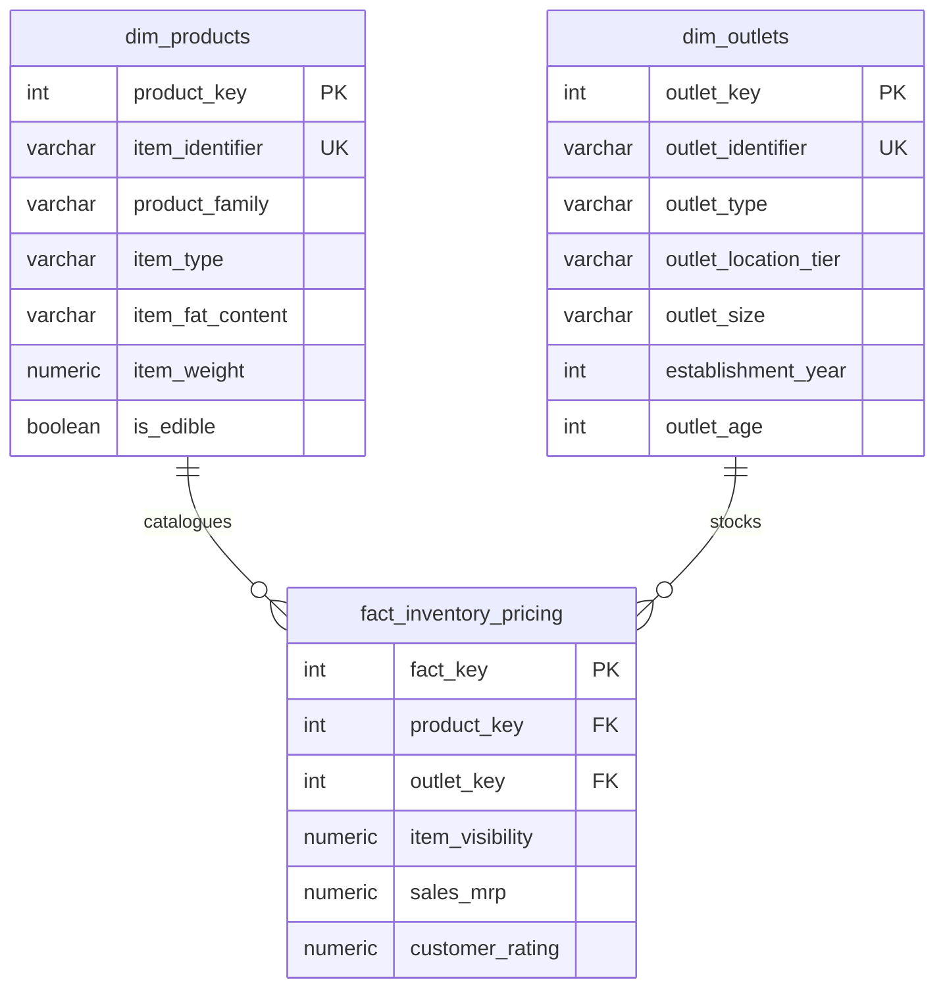

# BlinkIT Grocery Sales Analysis: Pricing Architecture & Catalogue Assortment Technical Guide

---

> **Note on Currency and Sales Semantics:** The raw dataset does not label its currency. Dollar symbols in this project are a display convention only, not proof that values are USD or INR. The `Sales` column behaves like a unit retail price/MRP; without transaction quantities or dates, its sums should be treated as catalogue-value comparisons, not confirmed consumer revenue or sales volume.

---

## 1. Executive Summary & Core Analytical Reframing

### What Does the "Sales" Column Actually Represent?
In conventional retail analytics, a `Sales` column represents total consumer revenue generated over a period (i.e., $\text{Units Sold} \times \text{Unit Price}$). However, an empirical variance decomposition reveals a fundamental reality about this dataset:

$$\text{Total Variance in Sales} = \text{Within-SKU Variance} + \text{Between-SKU Variance}$$

- **`Item Identifier` (SKU) explains 99.97% of the variance in `Sales` ($R^2 = 0.9997$).**
- Within a given SKU, the standard deviation across outlets is only **$1.15**, compared to an overall dataset standard deviation of **$62.28**.
- **`Outlet Identifier` explains only 0.03% of the variance.**
- **Finding:** The `Sales` column **behaves like / is consistent with Item Retail Price (MRP)** with slight store-level pricing variation.

### The Methodological Consequences:
1. **"Price Parity" is Mechanical:**  
   The observation that every store format, location tier, and store size has an average sale of ~\$140/item (exact range: **$139.42 to $143.12**) is not evidence of identical consumer purchasing velocity. It is a mathematical consequence of sampling from the same price catalogue: every row represents one SKU, and its "Sales" value is effectively its unit retail price.
2. **The Assortment Gap Model is an Inventory Potential Model:**  
   Supermarkets average **$131,258** in Sales-column value because they stock **930.0 SKUs** ($930 \times \$141.09 = \$131,213.70$). Grocery stores average **$75,970** because they stock **541.5 SKUs** ($541.5 \times \$140.29 = \$75,969.57$). Multiplying the 388.5 SKU gap by the average price yields **+$109,009 (9.07% network expansion)**. This quantifies **theoretical catalogue inventory value potential**, not guaranteed consumer demand.
3. **The Kruskal-Wallis Category Effect is Price Dispersion:**  
   The non-parametric Kruskal-Wallis test across categories ($H = 107.30, p = 5.31 \times 10^{-16}$) detects **category-level price differences** (Household and Dairy have higher unit prices than Baking Goods and Soft Drinks), which account for **1.25%** of price variance.
4. **Pareto Concentration Reflects Catalogue Breadth:**  
   Category share of listings correlates **0.997** with category share of sales. The top 5 categories comprise **57.26%** of all listings and **59.03% ($709,370)** of total Sales-column value. The Pareto distribution reflects **catalogue assortment concentration**, not organic sales velocity.

---

## 2. Dataset Architecture & Audited Data Dictionary

| Feature Name | Data Type | Audited Description & Domain Role |
|---|---|---|
| `Item Identifier` | Categorical / ID | Unique SKU code (1,559 distinct items). Prefix: `FD` (Food), `DR` (Drinks), `NC` (Non-Consumable). Explains 99.97% of `Sales` variance. |
| `Item Fat Content` | Categorical | Cleaned to `Low Fat`, `Regular`, and `Non-Edible` (for non-consumables). |
| `Item Type` | Categorical | 16 product categories. Category price differences explain 1.25% of price variance. |
| `Item Weight` | Numerical (float) | Physical weight. Missing in **1,463 rows (17.17%)**; imputed via cross-outlet SKU mean (within-SKU weight std is 0.00). |
| `Item Visibility` | Numerical (float) | Display ratio (0.00 to 0.33). Contains **526 zero values**. Grocery store visibility averages 0.111 vs 0.065 in supermarkets. |
| `Sales` | Numerical (float) | Unit retail price / MRP per product-outlet combination ($31.29 to $266.89). |
| `Rating` | Numerical (float) | Review score (1.0 to 5.0). 39.18% of rows sit at exactly 4.00. |
| `Outlet Identifier` | Categorical / ID | 10 stores (`OUT010` to `OUT049`). Explains only 0.03% of `Sales` variance. |
| `Outlet Establishment Year` | Integer | Founding year (2011 to 2022). |
| `Outlet Location Type` | Categorical | Urban tier (`Tier 1`, `Tier 2`, `Tier 3`). |
| `Outlet Size` | Categorical | Physical size (`Small`, `Medium`, `High`, `Unknown`). Split stores labeled `Unknown`. |
| `Outlet Type` | Categorical | Store format (`Grocery Store`, `Supermarket Type1`, `Supermarket Type2`, `Supermarket Type3`). |

### Engineered Features:
- `Item Category`: Product family derived from SKU prefix (`Food`, `Drinks`, `Non-Consumable`).
- `Outlet Size (Original)`: Historical size preserved before marking split stores as `Unknown`.
- `Outlet Age`: Operating longevity in years ($2026 - \text{Outlet Establishment Year}$).

---

## 3. Objective-by-Objective Technical Audit & Verified Numbers

---

### Step 0: Environment Setup & Raw Data Ingestion
- **Dataset Dimensions:** 8,523 rows $\times$ 12 columns.
- **File Handling:** Both `BlinkIT_Grocery_Data.xlsx` (standardized) and `BlinkIT Grocery Data.xlsx` (spaced) are supported with dynamic fallback.
- **Explicit Missing Values:** `Item Weight` is missing in **1,463 rows (17.17%)**, including 100% of rows in `OUT019` and `OUT027`.
- **Implicit Missing Values:** `Item Visibility` contains **526 rows with a value of 0.00**.
- **Categorical Inconsistencies:** `Item Fat Content` contains 5 variations for 2 classes (`low fat`, `LF`, `Low Fat`, `reg`, `Regular`).

---

### Objective 1: Understand the Business (Tasks 1.1 to 1.4)

#### Task 1.1: Product Assortment Analysis
- **Unique Products:** 1,559 distinct SKUs across 16 categories.
- **Product Family Split:**
  - **Food:** 6,125 records (**71.87%**)
  - **Non-Consumable:** 1,599 records (**18.76%**)
  - **Drinks:** 799 records (**9.37%**)
- **Top Categories by Volume:** Fruits and Vegetables (1,232 records), Snack Foods (1,200 records), Household (910 records).
- **Smallest Categories:** Seafood (64 records), Breakfast (110 records).

#### Task 1.2: Outlet Network Profiling
- **10 Fulfillment Outlets:**
  - 6 Supermarket Type 1 (OUT013, OUT017, OUT035, OUT045, OUT046, OUT049)
  - 1 Supermarket Type 2 (OUT018)
  - 1 Supermarket Type 3 (OUT027)
  - 2 Grocery Stores (OUT010, OUT019)
- **Urbanization Footprint:**
  - Tier 3: 4 outlets (OUT010, OUT018, OUT027, OUT049)
  - Tier 2: 3 outlets (OUT017, OUT035, OUT045)
  - Tier 1: 3 outlets (OUT013, OUT019, OUT046)

#### Task 1.3: Overall Sales Distribution (Exact Metrics)
- **Total Network Revenue:** **$1,201,681.49**
- **Mean Sales per Record:** **$140.99**
- **Median Sales per Record:** **$143.01**
- **Standard Deviation:** **$62.28**
- **Minimum Value:** **$31.29**
- **Maximum Value:** **$266.89**
- **Distribution Shape:** The distribution is **symmetric** around $140 ($\text{Skewness} = 0.127 \approx 0.13$). The alignment between mean ($140.99) and median ($143.01) confirms symmetry.

#### Task 1.4: Customer Rating Analysis
- **Mean Rating:** **3.97 / 5.00**; **Median Rating:** **4.00 / 5.00**.
- **Modal Spike at 4.0:** Exactly **39.18% of all rows (3,339 records)** sit at exactly 4.00.
- **Category Rating Spread:** Averages range in a tight band from **3.91 to 4.02**, providing zero practical differentiation between product lines.

---

### Objective 2: Make the Data Reliable (Tasks 2.1 to 2.4)

#### Task 2.1: Missing Value Imputation & Bias Diagnosis
1. **Item Weight Imputation (Exact):**  
   Physical weight never varies within an item (within-SKU weight standard deviation is 0.00). Imputing missing weights using cross-outlet SKU means is exact. For 4 SKUs never weighed in any outlet, the category median was used.
2. **Item Visibility Imputation (Bias Diagnosis):**  
   Non-zero visibility in Grocery Stores averages **0.111 (11.1%)**, compared to **0.065 (6.5%)** in Supermarkets. This is a structural feature of smaller stores (fewer SKUs = higher share of visual display per item). Imputing zeros with global cross-outlet SKU means pulls grocery store zeros toward supermarket levels.

#### Task 2.2: Duplicate Detection
- **Full Row Duplicates:** 0.
- **Composite Key Duplicates `(Item Identifier, Outlet Identifier)`:** 0.
- 100% of rows represent distinct SKU-store combinations.

#### Task 2.3: Outlier Detection and Retention Rationale
Tukey's IQR Rule ($\text{IQR} = Q_3 - Q_1$):
- `Sales`: $Q_1 = 93.83, Q_3 = 185.64, \text{IQR} = 91.82 \rightarrow \mathbf{0 \text{ outliers}}$.
- `Item Weight`: $Q_1 = 8.77, Q_3 = 16.85, \text{IQR} = 8.08 \rightarrow \mathbf{0 \text{ outliers}}$.
- `Item Visibility`: $Q_1 = 0.03, Q_3 = 0.09, \text{IQR} = 0.07 \rightarrow \mathbf{144 \text{ outliers}}$ ($1.69\%$).
- `Rating`: $Q_1 = 4.00, Q_3 = 4.20, \text{IQR} = 0.20 \rightarrow \mathbf{1,931 \text{ outliers}}$ ($22.66\%$).
- **Defense for Retaining 100% of Data:**
  - Visibility outliers represent genuine premium digital display banners and end-caps.
  - Rating outliers are an artifact of 39.18% modal clustering at 4.00, which compresses the IQR to 0.20 and creates a false cutoff at $4.0 - 1.5 \times 0.2 = 3.70$. Ratings below 3.70 are authentic customer feedback.

#### Task 2.4: Consistency Harmonization & Resolving Split Outlet Sizes
- Standardized `Item Fat Content` to `Low Fat` and `Regular`.
- Mapped Non-Consumables to `Non-Edible`.
- **Handling Split Outlet Sizes:**  
  Raw sizes inside three outlets were genuinely split:
  - `OUT010`: Medium 265, High 233, Small 57.
  - `OUT017`: Small 368, High 314, Medium 244.
  - `OUT045`: Medium 329, Small 326, High 274 (a 3-row difference between Medium and Small!).  
  Taking the mode overwrote 1,448 rows (17%). **Instead, we label these three outlets as `Unknown`**, preserving historical values in `Outlet Size (Original)` and excluding them from size comparisons.
- Calculated `Outlet Age` as $2026 - \text{Outlet Establishment Year}$.
- Exported cleaned dataset to `BlinkIT_Grocery_Data_Cleaned.csv`.

---

### Objective 3: What Drives Sales? (Tasks 3.1 to 3.4)

#### Task 3.1: Product Types and Sales Drivers
- **Top 5 Categories by Revenue:**
  1. Fruits and Vegetables: **$178,124.08** (14.82%)
  2. Snack Foods: **$175,433.92** (14.60%)
  3. Household: **$135,976.53** (11.32%)
  4. Frozen Foods: **$118,558.88** (9.87%)
  5. Dairy: **$101,276.46** (8.43%)
  - **Top 5 Cumulative Revenue:** **$709,369.87 (59.03%)**
  - **Top 8 Cumulative Revenue:** **79.06%**
  - **Top 10 Cumulative Revenue:** **88.87%**
- **Fat Content Revenue Share:**
  - Low Fat: **45.76%** ($549,871)
  - Regular: **35.40%** ($425,361)
  - Non-Edible: **18.84%** ($226,449)

#### Task 3.2: Outlet Attributes and Sales Impact
- **Total Sales by Store Format:**
  - Supermarket Type 1: **$787,549.89** across 6 outlets ($131,258.32/outlet)
  - Supermarket Type 2: **$131,477.78** (1 outlet)
  - Supermarket Type 3: **$130,714.67** (1 outlet)
  - Grocery Store: **$151,939.15** across 2 outlets (**$75,969.57/outlet**)
- **Total Sales by Urban Tier:**
  - Tier 3: **$472,133.03** ($118,033.26/outlet across 4 stores)
  - Tier 2: **$393,150.65** ($131,050.22/outlet across 3 stores)
  - Tier 1: **$336,397.81** ($112,132.60/outlet across 3 stores)
- **Mean Sales per Record across Outlets:** Ranges tightly between **$139.42 and $143.12**.

#### Task 3.3: Statistical Relationship Testing
- **Pearson Linear Correlation (Cleaned Data):**
  - Visibility vs Sales: $r = -0.0060, p = 0.5828$ (No relationship)
  - Weight vs Sales: $r = +0.0260, p = 0.0165$ (Negligible effect)
  - Rating vs Sales: $r = +0.0113, p = 0.2957$ (No relationship)
  - Outlet Age vs Sales: $r = +0.0007, p = 0.9518$ (No relationship)
- **Kruskal-Wallis Non-Parametric ANOVA Test:**
  - Across 16 Categories: $H = 107.30, p = 5.31 \times 10^{-16} < 0.05$ $\rightarrow$ **Statistically Significant**. Detects category price variations.
  - Across 4 Outlet Types: $H = 0.37, p = 0.947 > 0.05$ $\rightarrow$ **Not Significant**. Confirms outlets sample from the same price catalogue.

#### Task 3.4: Cohort Comparison (Top 25% vs Bottom 25%)
- Segmented into Top 25% ($\ge \$185.64$) and Bottom 25% ($\le \$93.83$).
- **Attribute Profile Comparison:**
  - Mean Outlet Age: **9.54 years (Top) vs 9.54 years (Bottom)**
  - Mean Item Weight: **13.07 kg (Top) vs 12.81 kg (Bottom)**
  - Mean Rating: **3.96 (Top) vs 3.97 (Bottom)**

---

### Objective 4: Actionable Business Decisions (Tasks 4.1 to 4.4)

#### Task 4.1: High-Impact Revenue Contributors & Pareto Analysis
- **Methodological Note on SKU Ranking:** Total SKU revenue correlates **0.5259 (≈ 0.53)** with the number of outlets stocking it. Ranking by total sales favors SKUs stocked in 9 stores over 6 stores. We report both **Mean Price (Unit Value)** and **Total Accumulated Sales**.
- **Top 5 SKUs by Mean Price:** `FDR25` ($265.47), `NCS29` ($265.46), `FDK51` ($265.42), `FDS13` ($265.30), `FDL58` ($263.96).
- **Top 5 SKUs by Total Revenue:** `FDU12` ($2,371.01 in 9 stores), `FDT07` ($2,306.90 in 9 stores), `NCQ06` ($2,294.71 in 9 stores), `FDL58` ($2,111.65 in 8 stores), `NCB31` ($2,104.73 in 8 stores).

#### Task 4.2: Outlet & Location Fair Comparison (Composition Effect & Store Format Confounding)
- **The Raw Illusion:** Tier 2 appears to lead at **$131,050.22/outlet** vs Tier 3 ($118,033.26) and Tier 1 ($112,132.60).
- **The True Driver (Composition Effect / Store Format Confounding):** Tier 2 contains **zero Grocery Stores** (all 3 are Supermarkets). Comparing overall tier averages conflates store format with geographic location.
- **Controlling for Store Format (Supermarkets Only):**
  - Tier 1 Supermarkets: **$131,295.11 / store**
  - Tier 2 Supermarkets: **$131,050.22 / store**
  - Tier 3 Supermarkets: **$131,333.82 / store**
- **Conclusion:** There is zero difference across tiers for supermarkets. Tier 2's apparent advantage is an artifact of having no smaller grocery store dragging down its average.

#### Task 4.3: Opportunity Areas & Assortment Gap Analysis
- Supermarkets carry an average of **930.0 SKUs**.
- Grocery Stores carry an average of **541.5 SKUs** (OUT010: 555, OUT019: 528).
- **Assortment Quality Check:** The 901 distinct SKUs stocked in Grocery Stores have **nearly identical average sales ($140.29 vs $141.09 in supermarkets)** and category mix (e.g., Fruits & Veg: 14.04% vs 14.52%). Grocery stores are not carrying inferior items; they simply carry fewer total items.

#### Task 4.4: Strategic Recommendations & Uplift Opportunity Modeling
- **The Catalogue Opportunity Model:**
  $$\text{Catalogue Gap} = 930.0 - 541.5 = 388.5 \text{ SKUs per Grocery Store}$$
  $$\text{Mean Sale per SKU in Grocery Stores} = \$140.2947$$
  $$\mathbf{\text{Network Uplift}} = 388.5 \text{ SKUs} \times 2 \text{ Stores} \times \$140.2947 = \mathbf{+\$109,008.97 \quad (\approx \$109\text{k})}$$
  $$\text{Percentage of Total Network Revenue} = \frac{\$109,008.97}{\$1,201,681.49} \times 100 = \mathbf{9.07\%}$$

---

## 4. Summary Table of 8 Tactical Recommendations

| # | Strategic Recommendation | Empirical Evidence | Business Impact & Operational Caveats |
|---|---|---|---|
| **1** | **Expand Grocery Store Assortment Breadth** | Grocery stores carry ~541.5 SKUs vs 930.0 in supermarkets; average unit price is nearly identical ($140.29 vs $141.09). | **+$109,009 theoretical catalogue value potential (+9.07% network expansion)**. Caveat: assumes physical dark store square footage exists and consumer demand scales linearly. |
| **2** | **Maintain Assortment Depth in Top 5 Categories** | Pareto analysis demonstrates Fruits & Veg, Snacks, Household, Frozen, and Dairy drive 57.26% of listings and 59.03% ($709,370) of catalogue value. | Preserves core catalogue coverage across essential household categories. |
| **3** | **Standardize Store Format over City Tier** | Supermarkets perform identically across all tiers (~$131.2k/store: Tier 1 $131,295, Tier 2 $131,050, Tier 3 $131,334). Tier 2 was higher only because it lacked grocery stores. | Prioritize dark store floor space standardization rather than geographical tier prioritization. |
| **4** | **Acknowledge Category Price Tiers** | Baking Goods has a lower unit price ($126.43/item). | Lower average price reflects product unit economics (MRP), not operational failure. Merchandising should focus on cross-category basket building. |
| **5** | **Audit In-App Visibility vs Unit Volume** | Item Visibility shows no correlation with price ($r = -0.0060, p = 0.58$). | Suggests shelf display algorithms operate independently of unit price. Needs validation against actual unit order logs when available. |
| **6** | **Redesign Customer Review System** | 39.18% of ratings sit at 4.0; tight band (3.91 to 4.02) provides zero product differentiation. | Shift from single 1-5 ratings to multidimensional metrics (Freshness, Delivery Speed, Packaging). |
| **7** | **Standardize Master Data Management (MDM)** | Inconsistent fat labels and conflicting store sizes (OUT010, OUT017, OUT045). | Eliminates data entry errors, streamlines search indexing, and strengthens customer trust. |
| **8** | **Optimize High-MRP SKU Distribution** | Total SKU sales correlates 0.53 with store presence count due to mathematical accumulation (count × unit price). | Ensuring high-unit-price SKUs are stocked across more outlets directly increases overall network catalogue capacity. |

---

## 5. Project Defense & Interview Q&A Guide

### Q1: "What does the Sales column really represent in this dataset?"
> **Answer:** "A rigorous variance decomposition reveals that `Item Identifier` explains 99.97% of the variance in `Sales`, with a within-SKU standard deviation of only $1.15 against $62.28 overall. Outlet explains only 0.03%. This means the `Sales` column behaves like / is consistent with the product's unit retail price (MRP) with minor store-level price variances, rather than transaction volume or register receipts."

### Q2: "Why is the grocery store gap an assortment gap rather than a velocity gap?"
> **Answer:** "Because average sales per stocked item are virtually identical across all stores (~$140), grocery stores lag in total revenue (~$75,970 vs ~$131,258 in supermarkets) simply because they stock ~541.5 items instead of 930. The 901 SKUs stocked across grocery stores have nearly identical average price ($140.29 vs $141.09) and category mix as supermarkets. Multiplying this 388.5 SKU gap across both stores by their average price yields a theoretical catalogue value of +$109,009 (+9.07%), though real-world realization depends on physical space and consumer demand."

### Q3: "Is Tier 2 genuinely the best market to expand into?"
> **Answer:** "No, that is a composition effect (confounding by store format). Tier 2 only appeared superior in aggregate because it contains zero grocery stores (all 3 outlets are supermarkets). When evaluating supermarkets alone, Tier 1 ($131,295), Tier 2 ($131,050), and Tier 3 ($131,334) perform identically. Therefore, expansion strategy should focus on store format selection rather than prioritizing specific geographic tiers."

### Q4: "Why did you mark OUT010, OUT017, and OUT045 as 'Unknown' for outlet size?"
> **Answer:** "In the raw data, those three outlets have genuinely split size entries across items—for example, OUT045 has 329 Medium, 326 Small, and 274 High. Forcing a modal assignment would arbitrarily overwrite 1,448 rows (17% of the data) on what is essentially a coin flip. Labeling them 'Unknown' and excluding them from size comparisons preserves methodological integrity."

### Q5: "How did you model this data for production analytics and reporting?"
> **Answer:** "I engineered an ANSI-compliant Star Schema warehouse (`blinkit_warehouse.sql` / `blinkit_warehouse.db`) separating dimensions (`dim_products`, `dim_outlets`) from a centralized fact table (`fact_inventory_pricing`) at the product-outlet grain. This schema supports five analytical views covering variance decomposition, assortment gap benchmarking, format-controlled tier normalization (Simpson's paradox prevention), category Pareto concentration, and grocery store SKU onboarding prioritization."

### Q6: "How can executive leadership interact with your assortment gap findings?"
> **Answer:** "I developed an interactive Streamlit simulation suite (`app.py`). It enables category managers and dark store operators to dynamically simulate SKU expansion in grocery dark stores (`OUT010` and `OUT019`), adjusting levers for SKU addition count, expected velocity (inventory turns/year), gross margin targets, and working capital holding costs to project net annual operating profit."

---

## 6. Dimensional Data Warehouse Architecture (Star Schema)

The analytical data layer is implemented as an ANSI SQL compliant relational Star Schema in `blinkit_warehouse.sql`, instantiated in `blinkit_warehouse.db` via `build_warehouse.py`:

### Production Analytical Views:
1. `vw_sku_pricing_variance`: Calculates within-SKU vs overall variance, min price, max price, and cross-store spread ($R^2 = 0.9997$).
2. `vw_outlet_assortment_gap`: Benchmarks each store against the supermarket baseline (930.0 SKUs), isolating the 388.5 SKU gap.
3. `vw_format_controlled_tiers`: Deconstructs average sales by Tier and Outlet Type to expose and eliminate the Simpson's paradox / composition effect.
4. `vw_category_pareto`: Windowed running cumulative contribution queries (`SUM(...) OVER (ORDER BY ...)`) tracking catalogue concentration.
5. `vw_missing_sku_prioritization`: Ranks missing SKUs for grocery stores by popularity across supermarkets and retail price.

---

## 7. Interactive Streamlit Decision Simulator (`app.py`)

The application delivers five operational decision modules:
- **Module 1: Dark Store Assortment Expansion Simulator:** Allows live adjustments of SKU expansion depth (0–388), annual inventory turns (4x–24x), gross margin % (10%–35%), and holding cost (5%–25%) to simulate net operating contribution.
- **Module 2: Pricing Architecture Inspector:** Visualizes SKU price consistency across stores and the mathematical proof of variance decomposition.
- **Module 3: Simpson's Paradox Auditor:** Features an interactive toggle contrasting naive aggregation vs format-controlled evaluation.
- **Module 4: SKU Recommendation Engine:** Filterable priority queue with downloadable procurement candidate lists.
- **Module 5: Live SQL Query Console:** Allows interactive query execution against `blinkit_warehouse.db`.
