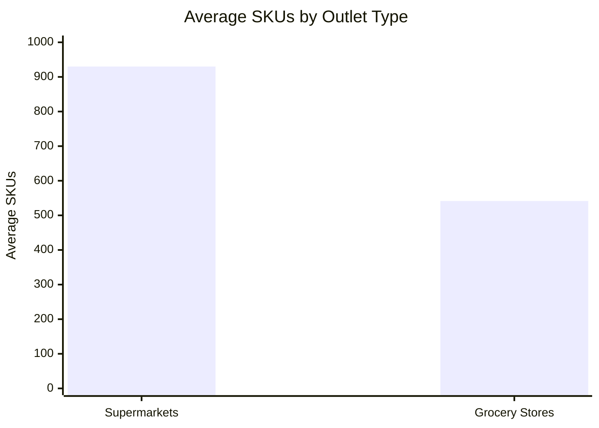
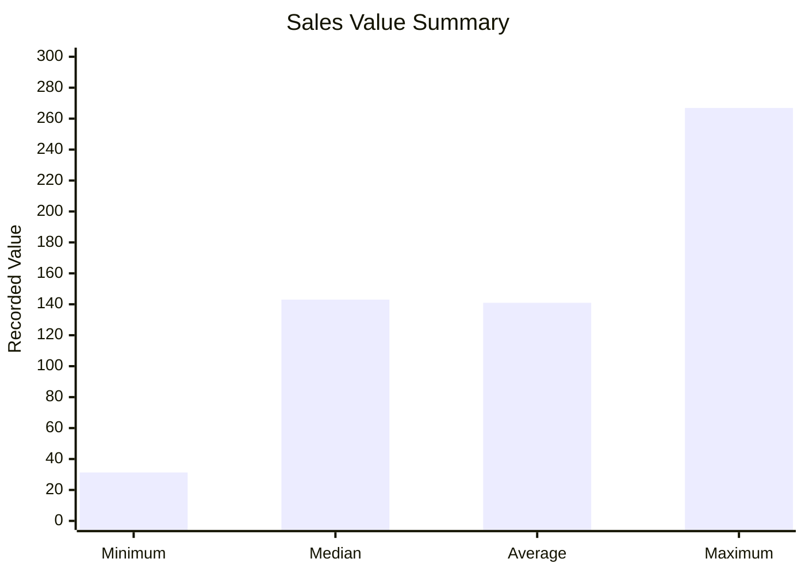
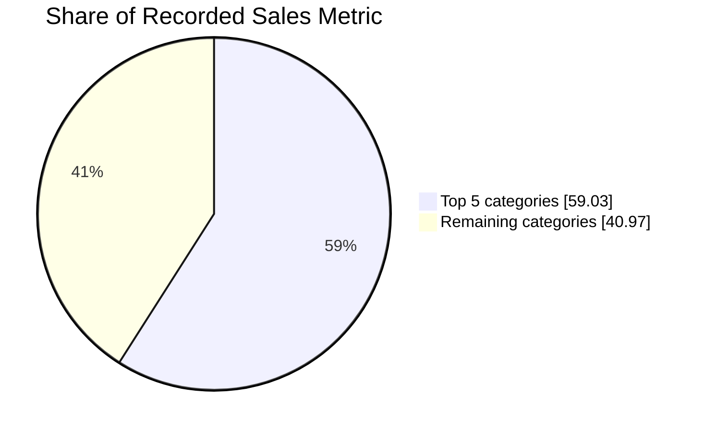

# 🛒 Blinkit Grocery Pricing & Catalogue Analysis


**An end-to-end data analytics project exploring grocery product pricing, catalogue distribution, outlet assortment, and customer ratings using Blinkit product and outlet data.**

> Explore the data, understand the key business metrics, and uncover insights into product assortment and pricing patterns.

---

## 📌 Table of Contents

- [📊 Project Overview](#-project-overview)
- [🎯 Business Objectives](#-business-objectives)
- [📈 Key Performance Indicators](#-key-performance-indicators)
- [🔍 Key Insights](#-key-insights)
- [📊 Data Visualizations](#-data-visualizations)
- [🧰 Tools and Technologies](#-tools-and-technologies)
- [🗂️ Project Structure](#️-project-structure)
- [⚙️ Analytical Approach](#️-analytical-approach)
- [⚠️ Data Limitations](#️-data-limitations)
- [💡 Recommendations](#-recommendations)
- [🚀 How to Explore](#-how-to-explore)
- [👩‍💻 Author](#-author)

---

## 📊 Project Overview

This project analyzes a Blinkit grocery catalogue dataset containing product and outlet-level records. The objective is to understand pricing patterns, category distribution, outlet assortment, and product ratings through data cleaning, exploratory data analysis, SQL-based data organization, and dashboard reporting.

The project demonstrates how raw retail catalogue data can be transformed into structured datasets and actionable business insights.

### Dataset at a glance

| Metric | Value |
|---|---:|
| Product-outlet records | 8,523 |
| Unique SKUs | 1,559 |
| Outlets | 10 |
| Product categories | 16 |
| Average Sales value | 140.99 |
| Average Rating | 3.97 / 5 |

---

## 🎯 Business Objectives

- Analyze product pricing and sales-value distributions.
- Understand product assortment across outlets.
- Identify categories contributing the largest share of the recorded Sales metric.
- Examine customer rating patterns.
- Compare catalogue breadth across outlet types.
- Build a reusable analytical workflow and interactive reporting experience.

---

## 📈 Key Performance Indicators

| KPI | Result |
|---|---:|
| Total recorded Sales | 1,201,681.49 |
| Average recorded Sales | 140.99 |
| Median recorded Sales | 143.01 |
| Minimum recorded Sales | 31.29 |
| Maximum recorded Sales | 266.89 |
| Standard deviation | 62.28 |
| Average rating | 3.97 |
| Records rated exactly 4 | 39.18% |

*Note: Currency units are not specified here. The Sales field behaves strongly like a product-level price or value rather than verified transaction revenue.*

---

## 🔍 Key Insights

### 1. Product and SKU patterns

The dataset contains 8,523 product-outlet records across 1,559 unique SKUs and 10 outlets. This supports comparisons of catalogue coverage and recorded product values.

### 2. Category concentration

The five largest categories account for approximately **59.03% of the summed Sales metric**.

This indicates that a substantial share of the recorded value is concentrated in a subset of categories.

### 3. Outlet assortment

| Outlet type | Average SKUs |
|---|---:|
| Supermarkets | 930 |
| Grocery Stores | 541.5 |

Supermarkets have a broader average assortment than grocery stores in this dataset.

### 4. Customer ratings

- Average rating: **3.97 out of 5**
- Records with a rating of exactly 4: **39.18%**

These metrics describe the rating distribution in the available records; they do not establish customer satisfaction drivers or sales impact.

### 5. Sales metric interpretation

SKU identity explains approximately **99.97% of the variance** in the recorded Sales field (R² = 0.9997).

This suggests the field may represent product pricing or another SKU-linked value. Its exact business meaning should be confirmed against the original data source before treating it as realized revenue.

---

## 📊 Data Visualizations

The following charts use the aggregate metrics available in this project summary. They are illustrative comparisons, not substitutes for charts built from the full dataset.

### Average catalogue assortment by outlet type



### Recorded Sales value distribution



### Category concentration

The top five categories account for **59.03%** of the summed Sales metric, with the remaining categories accounting for approximately **40.97%**.



---

## 🧰 Tools and Technologies

| Tool | Purpose |
|---|---|
| Python | Data cleaning and analysis |
| Pandas | Data manipulation |
| NumPy | Numerical calculations |
| Matplotlib / Seaborn | Data visualization, where used |
| SQL / SQLite | Structured storage and querying |
| Streamlit | Interactive dashboard |
| Jupyter Notebook | Exploratory analysis |
| GitHub | Project documentation and version control |

*The tools listed should match the libraries and applications actually used in the project.*

---

## 🗂️ Project Structure

```text
BlinkIT-Grocery-Sales-Analysis/
│
├── README.md
├── *.ipynb                  # Analysis notebook
├── *.csv                    # Cleaned dataset
├── *.db                     # SQLite database, if included
├── *.sql                    # SQL scripts, if included
└── *.py                     # Dashboard/application scripts, if included
```

*The filenames above describe expected file types. Replace the placeholders with the actual filenames in your repository.*

---

## ⚙️ Analytical Approach

1. **Data understanding** — reviewed the available product, outlet, category, pricing, and rating fields.
2. **Data preparation** — cleaned and organized the dataset for analysis.
3. **Exploratory data analysis** — examined summary statistics, value distributions, and category patterns.
4. **Outlet comparison** — compared catalogue assortment across outlet types.
5. **SQL organization** — structured the data for reusable queries and analytical access.
6. **Dashboard development** — prepared an interactive reporting experience for exploring key metrics.
7. **Business interpretation** — translated the results into findings while documenting data limitations.

---

## ⚠️ Data Limitations

- The dataset contains product-outlet records, not verified transaction-level sales.
- Transaction quantities and timestamps are not available in the described dataset.
- Actual units sold, revenue over time, demand trends, and seasonality cannot be established from these fields alone.
- The Sales field requires validation against the original source before being interpreted as revenue.
- Any catalogue-value opportunity estimate is a scenario, not confirmed incremental revenue, and should not be presented as a validated financial result.

---

## 💡 Recommendations

- **Review category concentration:** investigate the largest categories for assortment planning and catalogue management.
- **Compare outlet assortment:** examine whether differences in catalogue breadth align with outlet formats and customer needs.
- **Validate pricing fields:** confirm whether Sales represents price, item value, or another metric before calculating revenue.
- **Improve rating analysis:** investigate rating distributions by category and outlet where the underlying data supports it.
- **Add transaction data:** incorporate quantities, order dates, and realized prices to measure demand, revenue, and trends reliably.
- **Monitor data quality:** check for missing values, duplicate records, and inconsistent product identifiers.

---

## 🚀 How to Explore

1. Browse the files in this project folder.
2. Open the Jupyter Notebook to review the analysis.
3. Inspect the cleaned dataset and SQL/SQLite files if included.
4. Run the Streamlit dashboard if its application file and dependencies are available.

### Interactive project

If you publish the interactive HTML page using GitHub Pages, add its live URL here:

**[🌐 Open the Interactive Blinkit Analysis](YOUR_GITHUB_PAGES_URL)**

Replace `YOUR_GITHUB_PAGES_URL` with the actual published website URL. This link will not work until the site is deployed.

---

## 👩‍💻 Author

**Pooja Singh**

Data Analytics Portfolio Project

[GitHub Profile](https://github.com/PoojaS-1616)

---

⭐ If you find this project useful, feel free to explore the repository and share feedback.

*Built to demonstrate data cleaning, exploratory analysis, SQL data organization, visualization, and business interpretation using retail catalogue data.*
