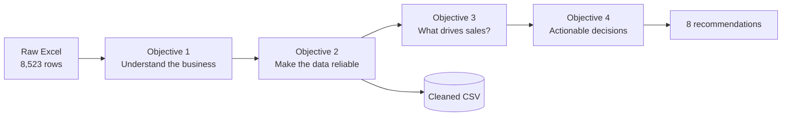
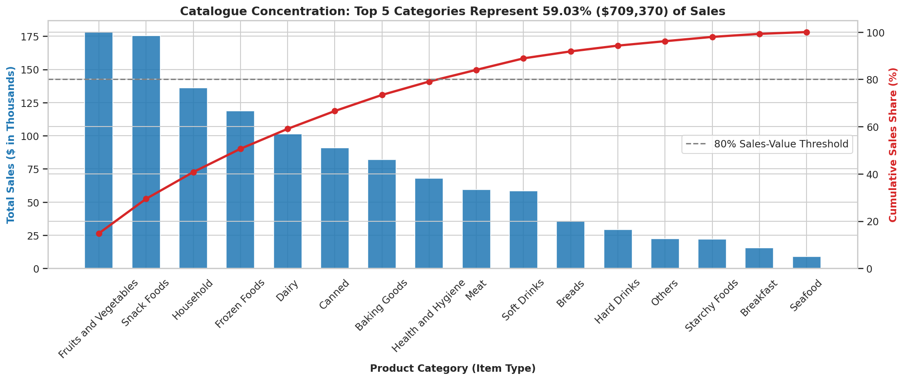
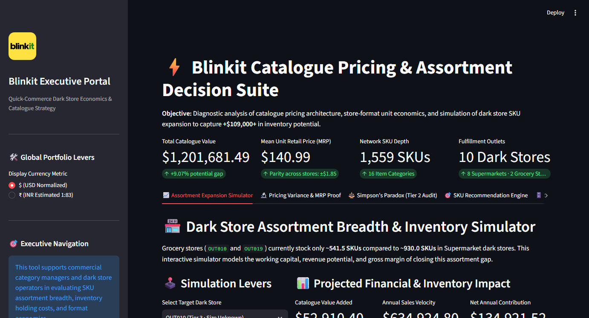

<div align="center">

# 🛒 BlinkIT Grocery Pricing & Catalogue Analysis

**What does the "Sales" column really measure? An exploratory analysis of 8,523 product–outlet records across 10 Blinkit outlets.**


[**Interactive project page**](https://claude.ai/artifact/Fs1xTUy46a39cPXm8o2NEn) · [Notebook](BlinkIT_Grocery_Sales_Analysis_v2.ipynb) · [Cleaned data](BlinkIT_Grocery_Data_Cleaned.csv) · [SQL warehouse](blinkit_warehouse.sql) 

</div>

---

## Contents

- [The headline finding](#the-headline-finding)
- [Dataset](#dataset)
- [Approach](#approach)
- [Results](#results)
- [Recommendations](#recommendations)
- [SQL warehouse and dashboard](#sql-warehouse-and-dashboard)
- [Data cleaning decisions](#data-cleaning-decisions)
- [Limitations](#limitations)
- [Getting started](#getting-started)
- [Repository structure](#repository-structure)

---

## The headline finding

A naive reading treats `Sales` as consumer turnover (units × price). A variance decomposition says otherwise:

| Factor | Share of `Sales` variance explained |
|---|---|
| `Item Identifier` (SKU) | **99.97%** (R² = 0.9997) |
| `Outlet Identifier` | **0.03%** |

Within a single SKU, Sales varies by only **$1.15** across outlets, against **$62.28** across the whole dataset. So `Sales` behaves like **Item Retail Price (MRP)**, not transaction volume. That reframes every other result:

1. Store-level price parity (~$140 per item) is mechanical: each store stocks a sample of the same price catalogue.
2. The revenue gap between Supermarkets and Grocery Stores comes from **catalogue breadth** (930.0 vs 541.5 SKUs), not value per item.
3. The category effect (Kruskal-Wallis H = 107.30, p = 5.31 × 10⁻¹⁶) is a **price-mix** effect, for example Household vs Baking Goods.
4. The $109k "uplift" is **theoretical catalogue value**, not guaranteed demand.

> **Currency note:** The raw data is unlabelled. Blinkit operates in India (₹), but values are shown with `$` to follow portfolio reporting conventions. The numbers are identical.

---

## Dataset

| | |
|---|---|
| **Source file** | `BlinkIT Grocery Data.xlsx` |
| **Records** | 8,523 product–outlet combinations |
| **Outlets / SKUs** | 10 / 1,559 |
| **Categories** | 16 item types in 3 families (Food 71.86%, Non-Consumable 18.76%, Drinks 9.37%) |
| **Cleaned output** | 8,523 rows × 15 columns |
| **Limitation** | Aggregated snapshot, no timestamps |

---

## Approach



| Objective | Tasks | Focus |
|---|---|---|
| **1. Understand the business** | 1.1 – 1.4 | Catalogue taxonomy, outlet topology, baseline sales metrics, ratings |
| **2. Make the data reliable** | 2.1 – 2.4 | Imputation, duplicates, outliers, label harmonisation |
| **3. What drives sales?** | 3.1 – 3.4 | Category and outlet drivers, correlations, Kruskal-Wallis, top vs bottom 25% cohorts |
| **4. Actionable decisions** | 4.1 – 4.4 | Pareto concentration, fair outlet comparison, assortment gap model, recommendations |

---

## Results

### Baseline

| Metric | Value |
|---|---|
| Total sales | $1,201,681.49 |
| Mean / median | $140.99 / $143.01 |
| Std. deviation | $62.28 |
| Range | $31.29 – $266.89 |
| Skewness | ≈ 0.13 (symmetric) |
| Mean rating | 3.97 / 5, with **39.18%** of records at exactly 4.0 |

### Catalogue concentration

The top 5 categories generate **59.03%** ($709,370) of catalogue value, the top 8 generate 79.06%, and the top 10 generate 88.87%. Fruits & Vegetables (14.82%) and Snack Foods (14.60%) lead. Household ($149.44) and Dairy ($148.50) have the highest average unit price, and Baking Goods ($126.43) the lowest.



### Outlet economics

| Store format | Total | Per outlet |
|---|---|---|
| Supermarket Type 1 (6 outlets) | $787,549.89 | $131,258.32 |
| Supermarket Type 2 (1 outlet) | $131,477.78 | $131,477.78 |
| Supermarket Type 3 (1 outlet) | $130,714.67 | $130,714.67 |
| Grocery Store (2 outlets) | $151,939.15 | **$75,969.57** (about 42% lower) |

Grocery Stores list 43% fewer items than the best outlet, yet their average unit price is only about 2% lower. The gap is **breadth, not quality**.

### The Tier 2 illusion

| Tier | All outlets | Supermarkets only |
|---|---|---|
| Tier 1 | $112,132.60 | $131,295.11 |
| Tier 2 | **$131,050.22** | $131,050.22 |
| Tier 3 | $118,033.26 | $131,333.82 |

Tier 2 looks best only because it has no Grocery Stores. Controlling for store format, all tiers perform the same. This is a composition effect.

### Statistical tests

| Test | Result |
|---|---|
| Outlet type vs Sales (Kruskal-Wallis) | H = 0.37, p = 0.947 |
| Visibility vs Sales | r = −0.0060, p = 0.58 |
| Rating vs Sales | r = +0.0113, p = 0.30 |
| Outlet age vs Sales | r = +0.0007, p = 0.95 |
| Item weight vs Sales | r = +0.0260, p = 0.017 (negligible) |

---

## Recommendations

| # | Recommendation | Evidence |
|---|---|---|
| 1 | **Expand Grocery Store assortment breadth** | 388.5 fewer SKUs per store at near-identical unit price; about +$109,009 theoretical (+9.07%) |
| 2 | **Maintain depth in the top 5 categories** | 59.03% of catalogue value |
| 3 | **Standardise by store format, not city tier** | Supermarkets perform the same in every tier |
| 4 | **Read category price tiers as unit economics** | Baking Goods averages $126.43 per item (MRP) |
| 5 | **Audit in-app visibility against unit volume** | Visibility vs Sales r = −0.0060 |
| 6 | **Redesign the review system** | 39.18% of ratings are exactly 4.0 |
| 7 | **Standardise master data** | Inconsistent fat labels; conflicting sizes at OUT010, OUT017, OUT045 |
| 8 | **Spread high-MRP SKUs across more outlets** | Total SKU sales correlate 0.53 with outlet count |

---

## SQL warehouse and dashboard

The cleaned data is also loaded into a SQLite star schema, which powers an interactive Streamlit dashboard.



**Star schema** (`blinkit_warehouse.sql`, built by `build_warehouse.py`):

| Table or view | Purpose |
|---|---|
| `dim_products` | One row per SKU: product family, category, fat content, weight |
| `dim_outlets` | One row per outlet: type, location tier, size, establishment year, age |
| `fact_inventory_pricing` | One row per product–outlet combination: price (MRP), visibility, rating |
| `vw_sku_pricing_variance` | Price variance per SKU, showing the SKU explains 99.97% of Sales variance |
| `vw_outlet_assortment_gap` | Assortment breadth gap: 541.5 SKUs per Grocery Store vs 930.0 per Supermarket |
| `vw_format_controlled_tiers` | Tier comparison within the same store format, showing the Tier 2 effect is composition |
| `vw_category_pareto` | Category concentration with running totals |
| `vw_missing_sku_prioritization` | SKUs stocked in all 8 supermarkets but missing from the 2 Grocery Stores |

**Dashboard tabs** (`app.py`): Assortment Expansion Simulator, Pricing Variance & MRP Proof, Simpson's Paradox (Tier 2 Audit), SKU Recommendation Engine, and SQL Star Schema Explorer.

---

## Data cleaning decisions

<details>
<summary><b>Item Weight</b>: 1,463 missing rows (17.16%)</summary>

Weight never varies within a SKU, so missing values are filled with the **SKU mean from other outlets**. The 4 SKUs never weighed anywhere take the category median.
</details>

<details>
<summary><b>Item Visibility</b>: 526 zero values</summary>

Imputed with SKU means. Grocery Stores have higher true visibility (0.111) than Supermarkets (0.065), so this slightly pulls Grocery Store values down. The bias is documented.
</details>

<details>
<summary><b>Fat content</b>: 5 labels for 2 values</summary>

Standardised to `Low Fat` and `Regular`. Non-Consumables had been tagged Low Fat and are now `Non-Edible`.
</details>

<details>
<summary><b>Outlet size</b>: three outlets with split values</summary>

OUT010, OUT017 and OUT045 report several sizes each (OUT045 splits 329 Medium vs 326 Small). Taking the mode would overwrite 1,448 rows (17%), so these outlets are labelled `Unknown` and the original is kept in `Outlet Size (Original)`.
</details>

<details>
<summary><b>Outliers</b>: kept, with reasons</summary>

Sales and weight have none. The 144 visibility outliers reflect deliberate merchandising. The 1,931 rating outliers appear only because 39.18% of ratings sit at exactly 4.0, which makes the IQR very narrow.
</details>

<details>
<summary><b>Engineered features</b></summary>

`Item Category` (from the SKU prefix: FD, DR, NC) and `Outlet Age` (2026 minus establishment year).
</details>

---

## Limitations

- **`Sales` is not transaction volume.** Conclusions concern catalogue value and pricing structure, not units sold.
- **The $109k uplift is theoretical.** It assumes demand scales with listings, which dark-store space may not allow.
- **Visibility imputation** slightly understates Grocery Store visibility.
- **No timestamps**, so seasonality and trend forecasting are out of scope.

---

## Getting started

```bash
git clone https://github.com/PoojaS-1616/data-analyst-portfolio.git
cd data-analyst-portfolio/BlinkIT-Grocery-Sales-Analysis
python -m pip install -r requirements.txt
```

**Option 1: notebook.** Open `BlinkIT_Grocery_Sales_Analysis_v2.ipynb` in Jupyter and run all cells. It reads the Excel file from its own folder and writes the cleaned CSV and figures.

```bash
jupyter notebook BlinkIT_Grocery_Sales_Analysis_v2.ipynb
```

**Option 2: script.** Run the whole analysis from the command line. It writes `BlinkIT_Grocery_Data_Cleaned.csv` and the figures in `visuals/`.

```bash
python run_analysis.py
```

**Option 3: dashboard.** Start the Streamlit app. If `blinkit_warehouse.db` is missing, the app builds it from the cleaned CSV on first run.

```bash
streamlit run app.py
```

---

## Repository structure

```
BlinkIT-Grocery-Sales-Analysis/
├── BlinkIT Grocery Data.xlsx                 # raw data
├── BlinkIT_Grocery_Data_Cleaned.csv          # cleaned data (8,523 rows x 15 columns)
├── BlinkIT_Grocery_Sales_Analysis_v2.ipynb   # full analysis notebook
├── run_analysis.py                           # same analysis as a script
├── blinkit_warehouse.sql                     # star schema and analytical views
├── build_warehouse.py                        # builds the SQLite database
├── app.py                                    # Streamlit dashboard
├── requirements.txt
├── dashboard_live_screenshot.png
├── dashboard_preview.png
├── visuals/                                  # figures from the analysis
└── README.md
```

---

**Author:** Pooja Singh · Built with Python, pandas, NumPy, Matplotlib, Seaborn, SciPy, SQL (SQLite), Plotly and Streamlit
