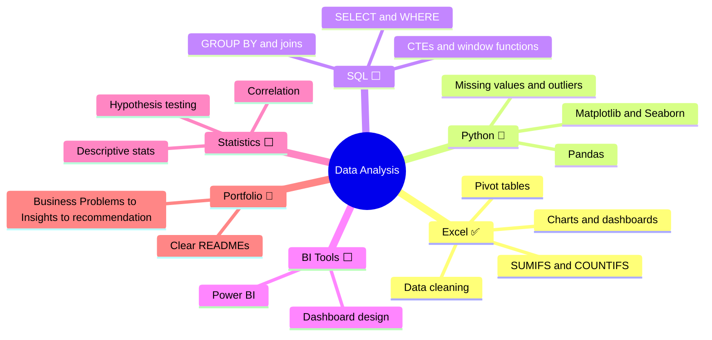

<<<<<<< HEAD
# BlinkIT Grocery Sales Analysis — Sapphire IQ Project

A Python-based analysis of BlinkIT grocery product and outlet records, aligned to the four objectives and 16 tasks in the Sapphire IQ project brief.

## Project status

- **PDF coverage:** All 16 tasks across Objectives 1–4 are covered in the V2 notebook.
- **Notebook execution:** `BlinkIT_Grocery_Sales_Analysis_v2.ipynb` was run from a fresh kernel in the project folder. All 33 code cells executed, each produced output, and no execution errors were reported.
- **Standalone analysis:** `run_analysis.py` completed successfully and exported its 10 core figures (13 panels).
- **SQL warehouse:** `build_warehouse.py` completed successfully with 8,523 fact records, 1,559 products and 10 outlets. The category Pareto view groups by item type so the Dairy category is not split by derived product-family labels.

## Project files

```text
BlinkIT_Grocery_Sales_Analysis_v2.ipynb  # Main analysis notebook, saved with outputs
BlinkIT Grocery Data.xlsx                # Raw source file supplied with the project
BlinkIT_Grocery_Data_Cleaned.csv          # Cleaned 8,523-row, 15-column dataset
visuals/                                 # Exported notebook and pipeline figures
run_analysis.py                          # Standalone analysis and figure-export pipeline
app.py                                   # Interactive Streamlit decision dashboard
blinkit_warehouse.sql                    # Star-schema DDL and analytical views
build_warehouse.py                       # Builds and verifies the SQLite warehouse
blinkit_warehouse.db                     # SQLite database
Project_Explanation.md                   # Detailed methods, findings and interview notes
Blinkit_Complete_File_by_File_Manual.md   # File-by-file technical guide
requirements.txt                         # Python dependencies
BlinkIT_Complete_Project_Flowchart.html  # Interactive workflow and completion status
PROJECT_REVIEW.md                        # Review against the PDF and validation results
Sapphire IQ Blinkit Grocery Sales Analysis.pdf  # Requirements brief
```

## Quick start

Use Python 3.10 or later and run these commands from this project folder:

```bash
python -m pip install -r requirements.txt
```

### Main notebook

Open `BlinkIT_Grocery_Sales_Analysis_v2.ipynb` in Jupyter or VS Code. To reproduce the analysis, choose **Restart Kernel and Run All Cells**. The raw Excel file should remain in the project root so the notebook can find it.

### Standalone analysis pipeline

```bash
python run_analysis.py
```

This reads the raw workbook, rebuilds the cleaned CSV and exports 10 core figures (13 panels) to `visuals/`.

### SQL warehouse

```bash
python build_warehouse.py
```

This rebuilds `blinkit_warehouse.db` from `BlinkIT_Grocery_Data_Cleaned.csv` and verifies the analytical views.

### Interactive dashboard

```bash
streamlit run app.py
```

## What the analysis covers

- **Objective 1:** Product assortment, outlet types and locations, overall value distribution, and ratings.
- **Objective 2:** Missing-value and zero-visibility audits, duplicate checks, IQR outlier review, and category/label standardisation.
- **Objective 3:** Category comparisons, outlet performance, correlation and variance analysis, and high-/low-value cohorts.
- **Objective 4:** Category concentration, fair outlet/location comparisons, assortment opportunities, and practical recommendations.

## Important interpretation limits

- The dataset has 8,523 product–outlet records, but no transaction dates, quantities, customer-level records, or costs.
- The `Sales` column has a narrow value range and is almost entirely explained by SKU identity. The project therefore treats it as **consistent with unit retail price/MRP**, not as confirmed transaction revenue or sales volume. Totals and the assortment-uplift estimate should be read as catalogue-value comparisons, not audited revenue or profit.
- The dataset does not label its currency. Dollar symbols in charts and text are a display convention, not evidence that values are USD or INR.
- Zero `Item Visibility` values are treated as data-quality anomalies and imputed using cross-outlet SKU information. This is a documented assumption, not proof of the original intended values.
- Outlet-size labels conflict for `OUT010`, `OUT017` and `OUT045`; those records are labelled `Unknown` for size-based comparisons.
- The original dataset's external source is not independently verified in this package.

## Charts

The notebook exports 12 chart files (including two supplemental cohort/outlet-gap charts). The standalone script exports 10 core figures with 13 panels. Their filenames differ, so both sets may appear in `visuals/` after both workflows have been run.

## Recommended submission contents

Submit the executed V2 notebook and this README. Include the cleaned dataset, figures, and report/SQL/dashboard assets if the submission accepts supporting files. Keep the raw workbook unchanged. GitHub publishing is optional unless explicitly required.
=======
# Data Analyst Portfolio

Business analytics projects in Excel and Python that turn sales data into clear findings and recommendations.

📫 [LinkedIn](https://www.linkedin.com/in/pooja-singh-data/) · ✉️ poojas.s199977@gmail.com

---

## 📁 Project Highlights

| Project | Tools | Headline finding | Link |
|---|---|---|---|
| 🇮🇳 **Amazon India Business Performance** | Excel | Electronics drives **79% of sales** from 30% of orders; **9.85%** of orders are lost to returns and cancellations | [Open Project →](./amazon-indian-business-dashboard-main) |
| 🛒 **Supermart Grocery Sales** | Excel | Sales growth is accelerating (**+28.6%** in 2018) and **discounts show no link to profit** | [Open Project →](./Supermart-Grocery-Sales-Dashboard) |

---

## 🧭 My Approach to Every Project

**Ask** a business question → **Clean** the data → **Explore** patterns → **Explain** in plain language → **Recommend** next steps

---

## Skills Used
- **Excel**: data cleaning, pivot tables, SUMIFS and COUNTIFS, charts and dashboards.
- **Python**: Pandas, NumPy, Matplotlib, Seaborn.
- **Tools**: Git and GitHub.

---

## 🗺️ Data Analysis Learning : A Project-Based Roadmap



I am building my skills project by project ✅ done in this repo · 🔄 in progress · ⬜ next

| Topic | Practice project |
|---|---|
| Excel |[Amazon India](./amazon-indian-business-dashboard-main) · [Supermart](./Supermart-Grocery-Sales-Dashboard) |

---
>>>>>>> origin/main
