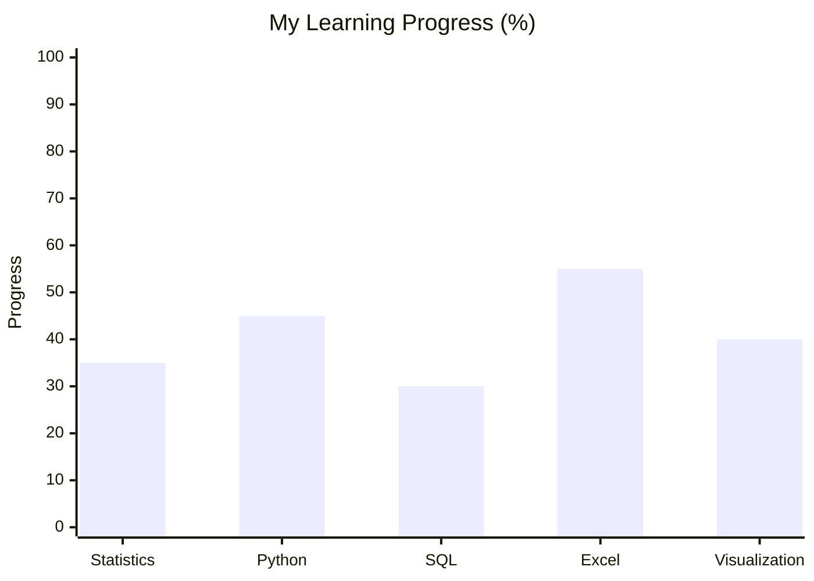
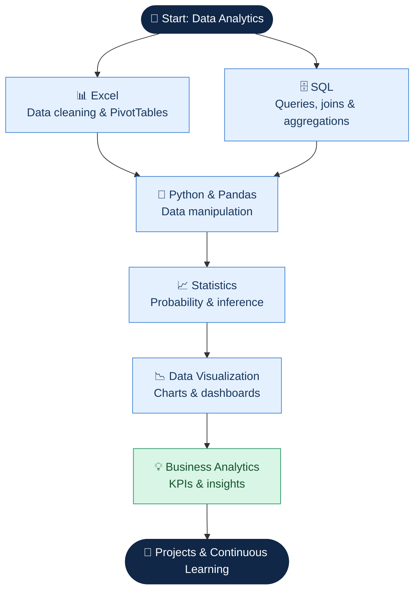

# Pooja Singh | Data Analytics Portfolio

Welcome to my Data Analytics Portfolio! This repository documents my hands-on projects, learning progress, statistical concepts, and practical exploration of data.

## 📊 Learning Progress

I track my progress as I develop my data analytics skills through practice, projects, and continuous learning.

*Note: The percentages are initial examples. Update them to reflect your actual progress.*

## 🧠 Statistics & Probability

Topics I am learning and practising:

<strong>Descriptive Statistics</strong>

- Mean, median, and mode
- Variance and standard deviation
- Quartiles and outliers
- Data distributions and skewness

<strong>Probability & Distributions</strong>

- Basic and conditional probability
- Random variables
- Normal and binomial distributions
- Sampling distributions

<strong>Statistical Inference</strong>

- Population and sample
- Sampling techniques
- Confidence intervals
- Central Limit Theorem

<strong>Hypothesis Testing</strong>

- Null and alternative hypotheses
- P-values and significance levels
- Type I and Type II errors
- t-tests, chi-square tests, and ANOVA

<strong>Correlation & Regression</strong>

- Correlation and covariance
- Simple and multiple linear regression
- Regression assumptions
- Interpreting relationships between variables

## 🛠️ Skills & Technologies

| Skill | Areas of Practice |
|---|---|
| Python | Data manipulation and analysis |
| Pandas | Data cleaning and transformation |
| SQL | Queries, joins, and aggregations |
| Microsoft Excel | Formulas, pivot tables, and dashboards |
| Statistics | Descriptive statistics, probability, and inference |
| Data Visualization | Charts, dashboards, and reporting |
| Business Analytics | KPI analysis and business insights |

## 🔄 My Interactive Learning Flowchart

Explore my learning journey from data preparation to business insights. Click a topic in the rendered diagram to open its learning notes or project.

*The flowchart represents a suggested learning sequence, not a claim that every stage is already completed. Update it as your skills develop.*

## 📂 Projects

### 1. BlinkIT Grocery Sales Analysis

- Explore grocery sales and business performance.
- Identify trends and key metrics.
- Interpret findings to support business decisions.

[View Project](./BlinkIT-Grocery-Sales-Analysis)

### 2. Supermart Grocery Sales Dashboard

- Analyze sales trends and performance.
- Present important metrics through visualizations.
- Explore dashboard design and business reporting.

[View Project](./Supermart-Grocery-Sales-Dashboard)

### 3. Amazon India Business Dashboard

- Analyze sales and profitability.
- Investigate category concentration.
- Examine returns, cancellations, and order outcomes.
- Develop data-driven business recommendations.

[View Project](./amazon-indian-business-dashboard-main)

## 📈 Learning Journey

My approach to data analytics is based on practical learning:

1. **Explore:** Understand the dataset and identify business questions.
2. **Clean:** Handle missing values, duplicates, and inconsistencies.
3. **Analyze:** Calculate metrics and investigate patterns.
4. **Visualize:** Communicate findings through charts and dashboards.
5. **Interpret:** Evaluate results and their business implications.
6. **Improve:** Validate calculations, document challenges, and refine the analysis.

## 💡 Learning Reflections

<strong>What I learned</strong>

Document new concepts, techniques, and analytical methods learned through projects.

<strong>Challenges I solved</strong>

Describe data quality issues, calculation errors, visualization challenges, and how they were addressed.

<strong>What I want to improve</strong>

- Statistical reasoning and hypothesis testing
- Python and SQL problem-solving
- Dashboard design and data storytelling
- Data validation and analytical accuracy

## 🗓️ Progress Log

Record meaningful milestones as you learn.

| Milestone | Notes |
|---|---|
| New concept | Add the topic and what you learned |
| Project milestone | Document your contribution and findings |
| Challenge solved | Explain the problem and solution |
| Next learning goal | Record what you plan to practise next |

## 🔗 Connect

- **GitHub:** [PoojaS-1616](https://github.com/PoojaS-1616)
- **LinkedIn:** Add your LinkedIn profile URL here.

---

*Learning through practice, improving through feedback, and growing with every dataset.*
