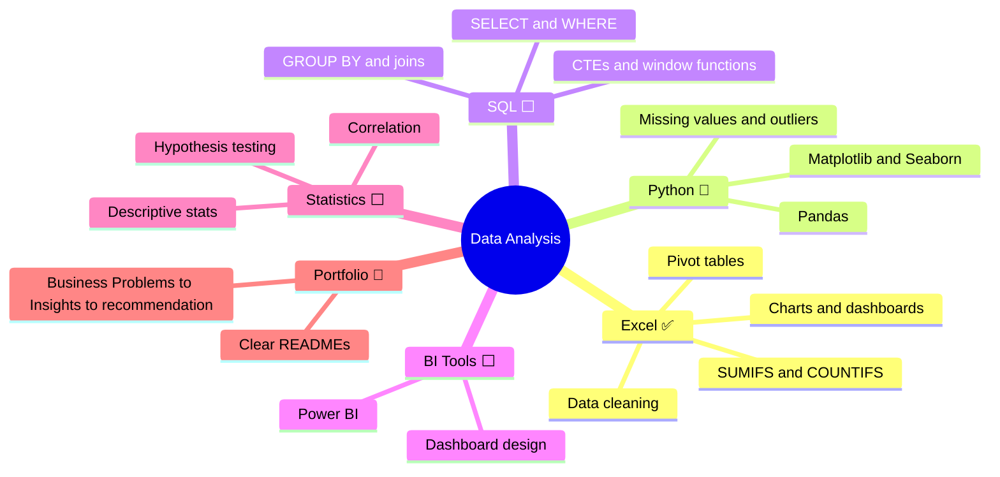

# Data Analyst Portfolio

Business analytics projects in Excel and Python that turn sales data into clear findings and recommendations.

📫 [LinkedIn](https://www.linkedin.com/in/pooja-singh-data/) · ✉️ poojas.s199977@gmail.com

---

## 📁 Project Highlights

| Project | Tools | Headline finding | Link |
|---|---|---|---|
| 🇮🇳 **Amazon India Business Performance** | Excel | Electronics drives **79% of sales** from 30% of orders; **9.85%** of orders are lost to returns and cancellations | [Open Project →](./amazon-indian-business-dashboard-main) |
| 🛒 **Supermart Grocery Sales** | Excel | Sales growth is accelerating (**+28.6%** in 2018) and **discounts show no link to profit** | [Open Project →](./Supermart-Grocery-Sales-Dashboard) |

---

## 🧭 My Approach to Every Project

**Ask** a business question → **Clean** the data → **Explore** patterns → **Explain** in plain language → **Recommend** next steps

---

## Skills Used
- **Excel**: data cleaning, pivot tables, SUMIFS and COUNTIFS, charts and dashboards.
- **Python**: Pandas, NumPy, Matplotlib, Seaborn.
- **Tools**: Git and GitHub.

---

## 🗺️ Data Analysis Learning : A Project-Based Roadmap

I am building my skills project by project ✅ done in this repo · 🔄 in progress · ⬜ next

| Topic | Practice project |
|---|---|
| Excel |[Amazon India](./amazon-indian-business-dashboard-main) · [Supermart](./Supermart-Grocery-Sales-Dashboard) |

---
