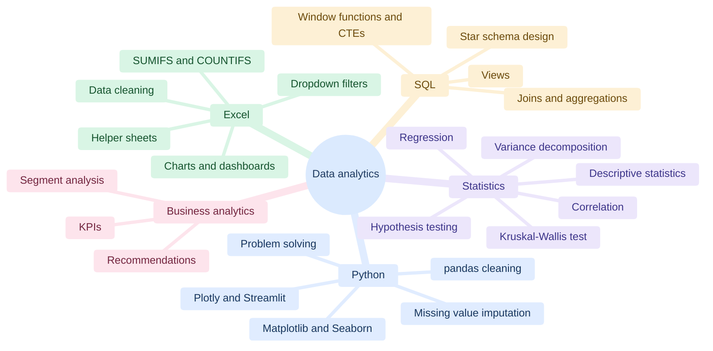

# Pooja Singh | Data Analytics Portfolio

Business analytics projects that turn raw sales data into clear findings and recommendations, built with Excel, Python and SQL.

📫 [LinkedIn](https://www.linkedin.com/in/pooja-singh-data/) · ✉️ poojas.s199977@gmail.com · 🐙 [GitHub](https://github.com/PoojaS-1616)

---

## 📂 Projects

| Project | Tools | Headline finding | Link |
|---|---|---|---|
| 🇮🇳 **Amazon India Business Performance** | Excel | Electronics drives **79% of sales** from 30% of orders; **9.85%** of orders are lost to returns and cancellations | [Open project →](./amazon-indian-business-dashboard-main) |
| 🛒 **Supermart Grocery Sales** | Excel | Sales growth is accelerating (**+28.6%** in 2018) and **discounts show no link to profit** | [Open project →](./Supermart-Grocery-Sales-Dashboard) |
| 🛍️ **BlinkIT Grocery Pricing & Catalogue** | Python, pandas, SciPy, SQL, Streamlit | The `Sales` column behaves like **item price, not units sold**: the item explains **99.97%** of its variance | [Open project →](./BlinkIT-Grocery-Sales-Analysis) |

### 1. Amazon India Business Performance Dashboard

- 10,000 orders turned into one formula-driven Excel dashboard: 6 KPIs, 9 charts, 4 business questions.
- Finds heavy dependence on one category (Electronics, 79% of sales) and a 9.85% loss rate that is similar in every category.
- Ends with data-driven recommendations on diversification, returns and growth.

### 2. Supermart Grocery Sales Dashboard

- 9,994 orders with Year, Region and Category dropdown filters that update the KPIs and charts.
- Shows sales growing every year, November as a peak month, and no link between discount level and profit.
- Flags sub-categories with high sales but below-average margin.

### 3. BlinkIT Grocery Pricing & Catalogue Analysis

- 8,523 product–outlet records across 10 outlets, analysed in Python with a documented cleaning process.
- Variance decomposition shows `Sales` reflects item price, which reframes every other result.
- Includes a SQL star-schema warehouse and a Streamlit decision dashboard.

---

## 🗺️ My data analytics map

**How every project flows:** ask a business question → clean the data → analyse → visualise → recommend next steps.

| Branch | See it in |
|---|---|
| Excel | [Amazon India](./amazon-indian-business-dashboard-main) · [Supermart](./Supermart-Grocery-Sales-Dashboard) |
| Python, Statistics | [BlinkIT analysis](./BlinkIT-Grocery-Sales-Analysis) |
| SQL | [BlinkIT SQL warehouse](./BlinkIT-Grocery-Sales-Analysis/blinkit_warehouse.sql) |
| Business analytics | The findings and recommendations in each project README |

---

## ☑️ Skill checklist

- [x] Learned and used in a project
- [ ] 🔄 In progress
- [ ] To do

<strong>Excel</strong>

- [x] Data cleaning
- [x] SUMIFS and COUNTIFS
- [x] Helper sheets
- [x] Dropdown filters
- [x] Charts and dashboards

<strong>Python</strong>

- [x] pandas cleaning
- [x] Missing value imputation
- [x] Matplotlib and Seaborn
- [x] Plotly and Streamlit
- [ ] 🔄 Problem solving

<strong>SQL</strong>

- [x] Star schema design
- [ ] 🔄 Joins and aggregations
- [ ] 🔄 Views
- [ ] Window functions and CTEs

<strong>Statistics</strong>

- [x] Descriptive statistics
- [x] Correlation
- [x] Variance decomposition
- [x] Kruskal-Wallis test
- [ ] 🔄 Hypothesis testing
- [ ] Regression

<strong>Business analytics</strong>

- [x] KPIs
- [x] Segment analysis
- [x] Recommendations

---

## 🛠️ Skills and where I used them

| Skill | What I practise | Used in |
|---|---|---|
| Microsoft Excel | Data cleaning, SUMIFS and COUNTIFS, helper sheets, dropdown filters, charts, dashboards | Amazon India, Supermart |
| Python (pandas, NumPy) | Cleaning, imputation, transformation | BlinkIT |
| Statistics | Correlation, variance decomposition, Kruskal-Wallis test | BlinkIT, Supermart |
| SQL | Star schema, joins, aggregations, views | BlinkIT |
| Data visualisation | Charts, dashboards, Matplotlib, Seaborn, Plotly, Streamlit | All three |
| Business analytics | KPIs, segment analysis, recommendations | All three |

---

## 🧠 Statistics and probability: what I am studying

<strong>Descriptive statistics</strong>

- Mean, median and mode
- Variance and standard deviation
- Quartiles and outliers
- Distributions and skewness

<strong>Probability and distributions</strong>

- Basic and conditional probability
- Random variables
- Normal and binomial distributions
- Sampling distributions

<strong>Statistical inference</strong>

- Population and sample
- Sampling techniques
- Confidence intervals
- Central Limit Theorem

<strong>Hypothesis testing</strong>

- Null and alternative hypotheses
- P-values and significance levels
- Type I and Type II errors
- t-tests, chi-square tests and ANOVA

<strong>Correlation and regression</strong>

- Correlation and covariance
- Simple and multiple linear regression
- Regression assumptions
- Interpreting relationships between variables

---

## 🎯 What I want to improve next

- Statistical reasoning and hypothesis testing
- Python and SQL problem-solving
- Dashboard design and data storytelling
- Data validation and analytical accuracy

---

## 🔗 Connect

- **LinkedIn:** [pooja-singh-data](https://www.linkedin.com/in/pooja-singh-data/)
- **GitHub:** [PoojaS-1616](https://github.com/PoojaS-1616)
- **Email:** poojas.s199977@gmail.com

---

*Learning through practice, improving through feedback, and growing with every dataset.*
