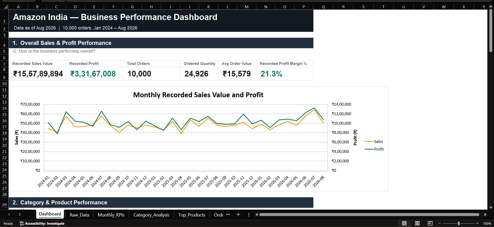

# Amazon India Business Performance Dashboard

An Excel dashboard that turns 10,000 Amazon India orders into a single dashboard sheet of KPIs, charts and findings.

## Dashboard Preview

## What it answers

**1. What is the overall recorded performance?**

Total recorded sales value, recorded profit, order count, total ordered quantity, average order value and recorded profit margin, plus monthly sales-value and profit trends from January 2024 to August 2026.

**2. Which categories and products contribute the most?**

Recorded sales value, profit and ordered quantity by category, plus the top 10 products by recorded sales value.

**3. What are the order outcomes?**

Counts of delivered, shipped, returned and cancelled orders, with returned and cancelled shares calculated against all recorded orders, plus a category-wise breakdown.

**4. Where does the recorded business value come from?**

Recorded sales value and profit by payment method and fulfilment method, plus recorded sales value, profit and order counts by state.

**Metric definitions:** Sales value and ordered quantity include all order statuses. They should not be interpreted as delivered sales or delivered units. Shipped orders are still in progress. Profit uses the values supplied in the dataset.

## What the data shows

- **Recorded sales and profit:** The dataset records approximately **₹15.58 crore in sales value** and **₹3.32 crore in profit**, giving a recorded profit margin of **21.29%**. Sales value includes returned and cancelled orders. Excluding those statuses, the recorded margin is **23.67%**.

- **Category concentration:** Electronics & Mobiles contributes approximately **79% of recorded sales value** from **30% of orders**, showing substantial dependence on one category.

- **Returned and cancelled orders:** There are **485 returned orders** and **500 cancelled orders**, representing **4.85%** and **5.00%** of all recorded orders. Their combined share is **9.85%**.

- **Associated sales value:** Returned and cancelled orders carry approximately **₹1.56 crore in recorded sales value**. This is the value associated with these statuses, not confirmed financial loss.

- **Category differences:** The combined returned and cancelled share ranges from approximately **8.8% to 10.6%** across categories. Electronics has the largest associated sales value because of its high contribution to overall sales.

- **Annual performance:** Recorded sales value increased from approximately **₹5.70 crore in 2024** to **₹5.74 crore in 2025**, a rise of **0.73%**. The 2026 data covers January to August and is excluded from this full-year comparison.

- **Payments and fulfilment:** UPI accounts for approximately **50% of recorded sales value**, while Amazon-fulfilled (FBA) orders account for approximately **69%**.

- **Geography:** Maharashtra, Karnataka and Delhi together contribute approximately **49% of recorded sales value**.
  
## Recommendations

1. **Review category concentration.** Electronics & Mobiles contributes approximately 79% of recorded sales value. Evaluate opportunities in Home & Kitchen and Apparel & Fashion through small, measurable pilots. Compare delivered order value, order counts and recorded margins before recommending wider expansion.

2. **Investigate returns and cancellations separately.** Capture reasons for each status, such as delivery problems, product issues or customer cancellation. Similar rates across categories justify checking shared processes, but do not establish a common cause. Prioritise Electronics for investigation because it has the largest recorded sales value associated with these statuses.

3. **Validate differences between business segments.** Compare return and cancellation rates across fulfilment methods, payment methods and states alongside their order counts. Check whether differences persist after considering category mix, order value and time period. Treat the observed gaps as hypotheses for investigation.

4. **Investigate the drivers of slow growth.** Recorded sales value increased by only 0.73% between 2024 and 2025. Break this change into order volume, average order value and category mix to identify which factors contributed. Compare equivalent periods when analysing the partial 2026 data.

## How it's built

The `Raw_Data` sheet stores the orders in an Excel Table named `RawData`. Summary formulas use table references, so additional records are included when they become part of this table.

The `Order_Month` calculated column derives a monthly grouping label from each order date.

| Sheet | Purpose |
|---|---|
| `Dashboard` | KPIs and charts answering four business questions |
| `Raw_Data` | Source records and the calculated `Order_Month` column |
| `Monthly_KPIs`, `Category_Analysis` | Monthly and category summaries |
| `Product_Summary` | PivotTable ranking the top 10 products by recorded sales value |
| `Top_Products` | Links the ranked products to the dashboard chart |
| `Order_Status`, `Category_Returns_Cancellations` | Order counts, status shares and category comparisons |
| `Payment_Analysis`, `Fulfillment_Analysis`, `State_Analysis` | Summaries by payment method, fulfilment method and state |

### Updating the dashboard

- With Excel calculation set to **Automatic**, formula-based summaries recalculate when the table data changes.
- Select **Data → Refresh All** to update the product PivotTable and Top 10 ranking. The PivotTable is also configured to refresh when the workbook opens.
- New records must be included within the `RawData` table.

### Current limitations

- Lists of months, categories, payment methods, fulfilment methods, states and order statuses are maintained manually. New labels require corresponding helper rows, formulas and chart-range updates.
- The dashboard's date-range and order-count subtitle is typed text and must be updated when the dataset changes.

## The dataset

10,000 orders from January 2024 to August 2026.

- **Each row has:** `Order_ID`, `Order_Date`, `Order_Month` (helper), `Category`, `Product`, `Quantity`, `Unit_Price_INR`, `Discount_Pct`, `Total_Sales_INR`, `Profit_INR`, `Payment_Method`, `Fulfillment`, `Order_Status` and `Ship_State`.

- **Important**: returned and cancelled orders still carry a sales value in the data, but their profit is zero. So Total Sales is the sales value recorded in the dataset (gross, including those orders), and the return and cancellation analysis shows the orders associated with those statuses.

## Tools

**Microsoft Excel:** Excel Tables, structured references, SUMIFS, COUNTIFS, TEXT, INDEX/MATCH, PivotTables and charts.

## Using it

1. Download [the Excel workbook](https://raw.githubusercontent.com/PoojaS-1616/data-analyst-portfolio/main/amazon-indian-business-dashboard-main/Amazon_India_Business_Performance_Dashboard.xlsx) and open it in Microsoft Excel.
2. Go to the **Dashboard** sheet. Set **Formulas → Calculation Options → Automatic** so formulas recalculate when data changes.
3. To add records, extend the `RawData` table on the `Raw_Data` sheet. Preserve the column headers, enter `Order_Date` as an Excel date, and check that the `Order_Month` formula fills into the new rows.
4. After changing data, select **Data → Refresh All** to refresh the product PivotTable and Top 10 ranking. If formula results remain unchanged, press **Ctrl + Alt + F9** to force recalculation.
5. If you introduce new months or grouping labels, update the relevant helper lists, formulas and chart ranges. Update the dashboard's typed date-range and order-count subtitle when needed.
6. Check the dashboard totals and product ranking, then save the workbook.

## What I learned

Designing for a non-technical reader changes the work. Choosing which numbers to leave out mattered as much as choosing which to show, and writing the business question above each section kept every chart tied to a business question.

