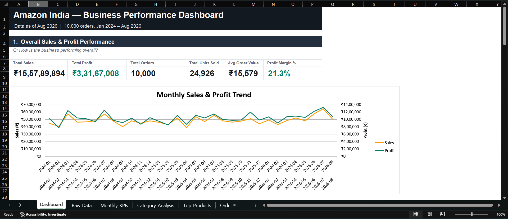

# Amazon India Business Performance Dashboard

An Excel dashboard that turns 10,000 Amazon India orders into a single dashboard sheet of KPIs, charts and findings.

## Dashboard Preview

## What it answers

**1. How is the business doing overall?**

Total sales, profit, orders, units sold, average order value and profit margin, plus a monthly sales and profit trend from January 2024 to August 2026.

**2. Which categories and products drive the business?**

Sales, profit and units by category, and the top 10 products by sales.

**3. How many orders are completed, and how many are lost?**

Delivered, shipped, returned and cancelled orders, with return and cancellation rates and a category-wise breakdown.

**4. Where does the business come from?**

Sales and profit by payment method and fulfilment method, and sales, profit and orders by state.

## What the data shows

- **Recorded sales and profit:** The dataset records approximately **₹15.58 crore in sales value** and **₹3.32 crore in profit**, giving a recorded profit margin of **21.29%**. Sales value includes returned and cancelled orders. Excluding those statuses, the recorded margin is **23.67%**.

- **Category concentration:** Electronics & Mobiles contributes approximately **79% of recorded sales value** from **30% of orders**, showing substantial dependence on one category.

- **Returned and cancelled orders:** There are **485 returned orders** and **500 cancelled orders**, representing **4.85%** and **5.00%** of all recorded orders. Their combined share is **9.85%**.

- **Associated sales value:** Returned and cancelled orders carry approximately **₹1.56 crore in recorded sales value**. This is the value associated with these statuses, not confirmed financial loss.

- **Category differences:** The combined returned and cancelled share ranges from approximately **8.8% to 10.6%** across categories. Electronics has the largest associated sales value because of its high contribution to overall sales.

- **Annual performance:** Recorded sales value increased from approximately **₹5.70 crore in 2024** to **₹5.74 crore in 2025**, a rise of **0.73%**. The 2026 data covers January to August and is excluded from this full-year comparison.

- **Payments and fulfilment:** UPI accounts for approximately **50% of recorded sales value**, while Amazon-fulfilled (FBA) orders account for approximately **69%**.

- **Geography:** Maharashtra, Karnataka and Delhi together contribute approximately **49% of recorded sales value**.
  
## Recommendations 

1. **Reduce reliance on Electronics.** With 79% of sales in one category, any problem there hits the whole business. Test growth in Home & Kitchen (about 11.5% of sales) and Apparel & Fashion (about 6.3%).
2. **Treat returns and cancellations as a business-wide problem.** Rates are similar in every category, so category-specific fixes will not solve it. Start with Electronics, where each lost order costs the most. The dataset has no return or cancellation reason, so the first step is to start capturing one.
3. **Investigate the higher-loss segments.** Seller Flex (11.2%) and Merchant-fulfilled (10.9%) orders are lost more often than FBA (9.3%). Card payments (11.0%) are lost more often than Amazon Pay Later (7.6%). Some states, such as Rajasthan (11.4%), are higher than Kerala (7.9%). These gaps are small and some groups have few orders, so treat them as hypotheses to test, not conclusions.
4. **Look for new growth.** With sales nearly flat between 2024 and 2025, the business needs a plan beyond the current mix.

## How it's built

The dashboard is driven by formulas. The `Raw_Data` sheet holds the orders, small helper sheets summarise them with SUMIFS and COUNTIFS, and the dashboard's KPIs and charts read from those helpers.

If the raw data changes, the numbers and charts update on their own.

| Sheet                                                        | What it does                                          |
| ------------------------------------------------------------ | ----------------------------------------------------- |
| `Dashboard`                                                  | The one-sheet view: KPIs, charts and four sections |
| `Raw_Data`                                                   | The 10,000 orders, plus an `Order_Month` helper column (text such as `2024-04`)|
| Monthly_KPIs, Category_Analysis, Top_Products                | Summary tables behind sections 1 and 2                |
| Order_Status, Category_Returns_Cancellations                 | Summary tables behind section 3                       |
| Payment_Analysis, Fulfillment_Analysis, State_Analysis       | Summary tables behind section 4                       |
---

- **What updates automatically:** if order values change, the totals and charts recalculate. The formulas read Raw_Data rows 2 to 10,001.

- **What does not:** the lists of months, categories, products, payment methods and states are typed in, so new categories or states must be added by hand. The Top 10 products list is also typed in and will not re-rank by itself.

---

## The dataset

10,000 orders from January 2024 to August 2026.

- **Each row has:** `Order_ID`, `Order_Date`, `Order_Month` (helper), `Category`, `Product`, `Quantity`, `Unit_Price_INR`, `Discount_Pct`, `Total_Sales_INR`, `Profit_INR`, `Payment_Method`, `Fulfillment`, `Order_Status` and `Ship_State`.

- **Important**: returned and cancelled orders still carry a sales value in the data, but their profit is zero. So Total Sales is the sales value recorded in the dataset (gross, including those orders), and the return and cancellation analysis shows the orders associated with those statuses.

## Tools

**Microsoft Excel:** SUMIFS, COUNTIFS, helper sheets and charts.

## Using it

1. Download `Amazon_India_Business_Performance_Dashboard.xlsx` from this repository.
2. Open it in Excel and go to the **Dashboard** sheet.
3. To try your own data, paste it into `Raw_Data` using the same columns, including `Order_Month` in the format `YYYY-MM`. The formulas stop at row 10,001, so if you add more orders, extend the ranges in the helper sheets and Dashboard too. Keep the same categories, states and months, or add new ones to the helper sheets.
4. Press Ctrl + Alt + F9 to recalculate if the numbers do not refresh.

## What I learned

Designing for a non-technical reader changes the work. Choosing which numbers to leave out mattered as much as choosing which to show, and writing the business question above each section kept every chart tied to a business question.

